# 声屿 Aural · AI 语音工作台 产品需求文档（PRD）

| 项目 | 内容 |
|---|---|
| 产品名 | 声屿 Aural（工作名，可替换） |
| 文档版本 | v1.5 |
| 日期 | 2026-10-31 |
| 状态 | **待评审**（UI/UX 评审 + 技术方案评审通过后进入开发任务拆解） |
| 文档定位 | 可直接交给 AI 编程 Agent 作为开发依据 |
| 调研基准日 | 2026-10-31，价格与许可证均标注该日期 |
| 配套文档 | 《语音能力选型调研》《语音能力需求调研报告》（同目录） |

**本版不做什么**：不写生产代码，只给出接口契约、状态机、设计规范与验收标准；可交互高保真原型（`aural-prototype-v1.html`）用于设计评审，不是交付物。开发任务拆解放在评审通过后的独立文档。

**修订记录**

| 版本 | 日期 | 变更 |
|---|---|---|
| v1.0 | 2026-10-31 | 首版：22 章完整 PRD |
| v1.1 | 2026-10-31 | 确认 5 项决策；默认引擎改为国内可直连方案；补充国内 API 与备案要求；UI/UX 增补组件规范与状态矩阵；附高保真原型 |
| v1.2 | 2026-10-31 | 首页改为单一焦点（模式轨道 + 单入口 + 光幕转场）；球体改为 WebGL 着色器；播放器重做为真实音频驱动的频谱舞台；新增开源参考与取舍、WebGL 性能预算 |
| v1.3 | 2026-10-31 | 删除首页全部按钮与 CTA，球体成为唯一控件（按住说话）；新增聆听/识别态与实时频谱环、打字机转录；移除 hover 位移与磁吸；补充 voice-first 参考 |
| v1.4 | 2026-10-31 | 补齐首页双向闭环：回车即由球体朗读，不再跳转；新增 speaking 态、声呐环、Enter 停止/重读；明确原型与生产在朗读可视化上的差异 |
| v1.5 | 2026-10-31 | 首页新增标注式音色/引擎选择器（球体右上引线胶囊 + 浮层试听），不新增垂直布局；补充组件规范与 Voice Picker 参考 |

---

## 0. 假设与待确认项

你给的方向足够清晰，但有 10 个点会显著影响实现，先按合理默认值推进，并在第 21 章登记为待确认。其中 5 项已在 v1.1 确认，见下方决策记录。

**决策记录（v1.1 已确认）**

| # | 决策 | 结论 |
|---|---|---|
| D1 | 产品名 | 暂用「声屿 Aural」，上线前可替换 |
| D2 | 目标市场 | 中英双语首发，**中国大陆可直连** |
| D3 | 账号体系 | 匿名会话，不做注册登录 |
| D4 | 选型偏好 | 便宜、稳定优先，音色表现力其次 |
| D5 | 工期 | 接受 7.5 周 MVP |

| ID | 假设 | 默认取值 | 影响面 | 需确认 |
|---|---|---|---|---|
| A1 | 目标市场 | 中英双语首发，**中国大陆可直连**（主区域国内） | 模型与区域选择 | ✅ 已确认 |
| A2 | 账号体系 | MVP 不注册登录，匿名会话（httpOnly Cookie + 设备指纹） | 数据归属与迁移 | 是否需要登录 |
| A3 | 声音克隆 | MVP 不做，Phase 3 做 | 合规与滥用防护 | 是否提前 |
| A4 | 部署区域 | 国内单区域（阿里云华东/华北），海外节点二期再加 | 延迟、备案与成本 | ✅ 已确认国内优先 |
| A5 | 团队 | 2–3 人（1 前端 + 1 全栈 + 兼职设计） | 排期 | 实际人力 |
| A6 | 预算 | MVP 月基础设施 + API < $200 | 供应商档位 | 上限 |
| A7 | 文本上限 | 单次 5,000 字符；超长走分段任务 | 分段与计费 | 是否需要 5 万字 |
| A8 | 音频上限 | 上传 ≤20MB、时长 ≤30 分钟 | 转码与超时 | 是否要 2 小时 |
| A9 | 浏览器 | Chrome/Edge 最近两个大版本、Safari ≥16.4 | 录音与音频 API | 是否兼容旧版 |
| A10 | 对外承诺 | MVP 为公开测试，不承诺 SLA | 可用性设计 | 是否对外运营 |

**关键待确认（阻塞开发任务拆解）**：A1、A2、A4。其余可以并行开工。

---

## 1. 项目概述

### 1.1 一句话

一个把文字变成声音、把声音变回文字的工作台，视觉上像一间「声音工作室」，而不是一个后台表单。

### 1.2 要解决的问题

现有工具三类毛病：一是纯功能型，界面像 2015 年的表单；二是纯 AI 聊天型，语音只是附件；三是音质不错但流程割裂——生成完要下载、再上传到别处。声屿要把「输入 → 生成 → 试听 → 带走」做成一条连续的路径，并且让声音**可见**。

### 1.3 产品边界

- 做：TTS、STT、音色选择、音频资产管理、可扩展的模型接入层。
- 不做（v1）：AI 对话、声音克隆、多角色、账号权限、付费。
- 未来做：以「Provider 可插拔」为前提预留，不在 MVP 里埋半成品。

### 1.4 差异化

| 维度 | 普通 TTS 工具 | 声屿 |
|---|---|---|
| 首屏 | 表单堆叠 | 一个会呼吸的声音球 + 两条主路径 |
| 声音呈现 | 一条进度条 | 真实音频频谱驱动的波形与光场 |
| 状态表达 | loading 转圈 | 分阶段可解释状态（排队/合成/编码） |
| 专业感 | 参数全铺开 | 默认参数即可出好结果，高级参数折叠 |

---

## 2. 产品定位

**定位语**：给创作者和开发者的 AI 声音工作台——听得见质感，看得见声音。

**产品人格**：安静、克制、精密。像一个声学实验室，而不是一个营销页。

**竞争位置**：比在线 TTS 工具更专业（有引擎选择、参数、资产管理），比云厂商控制台更好用（有设计、有引导、有试听），比 AI 聊天产品更聚焦（不做对话，只做声音）。

**不追求**：一站式内容生产、团队协作、企业级权限。这些会把 MVP 拖死。

---

## 3. 产品目标

### 3.1 北极星指标

**周成功转换次数**（TTS 生成成功 + STT 识别成功，去重按会话）。

### 3.2 分层目标

| 层级 | 指标 | 3 个月目标 | 说明 |
|---|---|---|---|
| 激活 | 首访到首次成功生成 | ≥ 45% | 首页到出音频 |
| 效率 | TTS 从点击到首帧音频 | p50 ≤ 1.5s | 短文本（<200 字） |
| 质量 | 生成后 24h 内下载/复听率 | ≥ 35% | 判断是否真的可用 |
| 留存 | 7 日回访率 | ≥ 20% | 匿名会话口径 |
| 稳定 | 任务失败率 | ≤ 2% | 含供应商错误 |

### 3.3 非目标

不做「生成即分享」的社区，不做模板市场，不做团队空间。MVP 阶段任何增加入口的想法都应先被拒绝一次。

---

## 4. 目标用户与使用场景

### 4.1 用户画像

| 用户 | 特征 | 核心诉求 | 典型路径 | 关键设计点 |
|---|---|---|---|---|
| 普通用户 C1 | 偶尔用，不懂参数 | 粘一段文字，出来能听的声音 | 首页 → TTS → 选默认音色 → 生成 → 下载 | 零配置可出结果；默认音色要好听 |
| 内容创作者 C2 | 短视频/播客/有声内容 | 音色稳定、可调语速、批量、可下载 | TTS → 调参 → 试听多音色 → 生成 → 下载 | 音色试听要快；参数要可保存 |
| 开发者 C3 | 评估模型，做集成 | 对比不同引擎、看延迟、要 API | 引擎切换 → 同文本多引擎对比 → 查文档 | 引擎可见可切；暴露真实耗时 |
| AI 产品使用者 C4 | 把 LLM 输出读出来 | 快、长文本不崩、能复制 | 粘贴长文 → 生成 → 播放 | 长文本分段与进度；失败可续 |
| 转写用户 C5 | 会议/采访/课程 | 准确、能编辑、能导出 | 录音或上传 → 识别 → 改错字 → 导出 | 录音状态清晰；结果可编辑 |

### 4.2 核心场景（Jobs to be Done）

1. 「我要把这篇 800 字的稿子变成女声旁白，语速慢一点。」→ TTS，参数可调，试听即所得。
2. 「我录了一段 3 分钟的采访，想要文字稿。」→ STT，录音或上传，结果可编辑导出。
3. 「我想比较三家引擎读同一句话的差别。」→ 引擎切换 + 一键重生成。
4. 「我昨天生成的音频想再下载一次。」→ 历史记录，带引擎与音色标签。

### 4.3 不服务的人群

专业配音演员的精细后期（需要 DAW 集成）、需要 100 人协作的团队、需要合规审计的企业采购。MVP 不为其做设计。

---

## 5. 产品功能架构

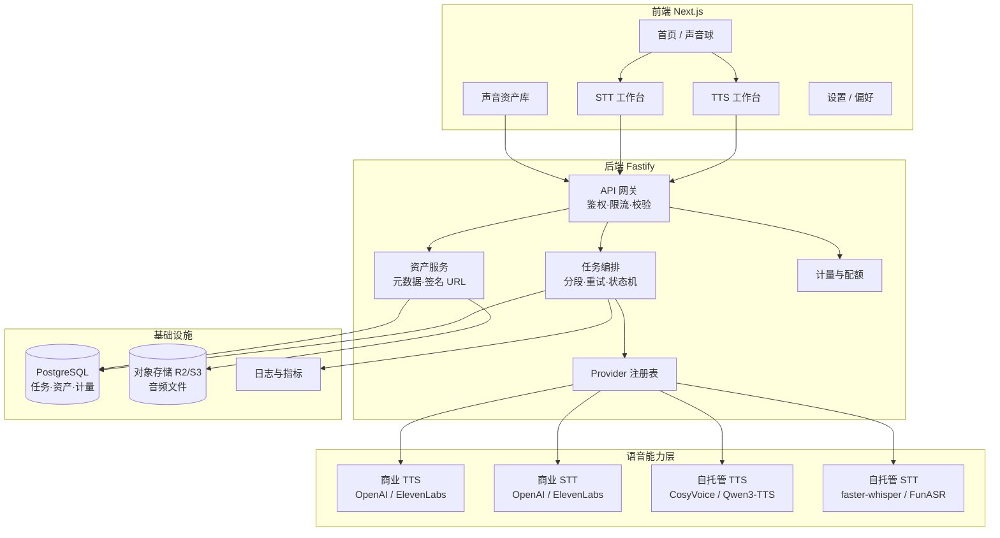

**分层原则**

1. 前端只认「引擎 ID / 音色 ID」，不认厂商名字。
2. 业务层只认 `TTSProvider` / `STTProvider` 接口。
3. 供应商能力差异（是否支持 SSML、是否支持流式）通过**能力声明**暴露，由前端降级渲染，而不是在业务逻辑里写 if。

**功能地图**

| 一级 | 二级 | MVP |
|---|---|---|
| 首页 | 声音球、双入口、最近记录 | ✅ |
| TTS | 文本编辑、引擎/音色、参数、生成、播放器、下载 | ✅ |
| STT | 录音、上传、识别、编辑、导出 | ✅ |
| 资产库 | 生成记录、识别记录、播放、下载、删除 | ✅（本地会话级） |
| 设置 | 默认引擎、默认音色、数据清理 | ✅（轻） |
| 扩展 | AI 朗读、多角色、克隆、实时对话 | Phase 2/3 |

---

## 6. 功能详细需求

优先级：P0 = MVP 必须，P1 = MVP 内可延后一周，P2 = 上线后补。

### 6.1 Text to Speech

#### 6.1.1 文本输入

| ID | 需求 | 优先级 | 交互与验收 |
|---|---|---|---|
| TTS-IN-01 | 多行文本输入，自适应高度 | P0 | 初始 6 行高，随内容增长到 60vh 后内部滚动 |
| TTS-IN-02 | 实时字符计数 | P0 | 右下角常驻；<80% 灰、80–100% 琥珀、超限红色并禁用生成 |
| TTS-IN-03 | 粘贴 | P0 | 支持 Cmd/Ctrl+V；粘贴超长文时截断并提示 |
| TTS-IN-04 | 清空 | P0 | 有内容才显示；点击后 5 秒内可撤销（toast） |
| TTS-IN-05 | 长度限制 | P0 | 单次 5,000 字符；超出时提示「超出 N 字，可分段生成」 |
| TTS-IN-06 | 超长分段 | P1 | 按句末标点切分为 ≤1,000 字符片段，顺序合成并拼接；显示「第 x/y 段」 |
| TTS-IN-07 | 草稿自动保存 | P1 | 本地保存最近一次输入，刷新不丢；与账号无关 |

**文案规则**：错误提示说「怎么办」，不说「哪里错了」。例：「文本超过 5,000 字，已为你选中可分段的部分」而不是「参数错误 400」。

#### 6.1.2 语音配置

| ID | 需求 | 优先级 | 交互与验收 |
|---|---|---|---|
| TTS-CFG-01 | 引擎选择 | P0 | 下拉展示引擎名 + 能力标签（如「流式」「低延迟」）；切换时保留文本，音色重置为默认并提示 |
| TTS-CFG-02 | 语言选择 | P0 | 中/英/自动；选「自动」时由引擎能力决定，不支持则禁用并说明 |
| TTS-CFG-03 | 音色列表 | P0 | 卡片列表，显示音色名、性别、风格标签、适用语种 |
| TTS-CFG-04 | 音色试听 | P0 | 悬停/聚焦出现播放按钮；试听固定示例句，≤10 秒；同一时间只允许一个试听 |
| TTS-CFG-05 | 语速 | P0 | 0.5–2.0，步进 0.05，默认 1.0；拖动时显示数值 |
| TTS-CFG-06 | 音调 | P1 | -12 ~ +12 半音；引擎不支持时置灰并显示 tooltip |
| TTS-CFG-07 | 音量 | P1 | 0.2–2.0；同上，不支持则置灰 |
| TTS-CFG-08 | 能力差异呈现 | P0 | 每个参数旁有状态：可用 / 不支持 / 仅部分音色可用；不隐藏、不静默失败 |
| TTS-CFG-09 | 参数记忆 | P1 | 记住上次选择（引擎、音色、语速），存 localStorage |

**关键约束**：能力声明来自后端 `capabilities` 字段，前端不得硬编码厂商能力。新增引擎只需后端注册。

#### 6.1.3 生成与状态

| ID | 需求 | 优先级 | 交互与验收 |
|---|---|---|---|
| TTS-GEN-01 | 生成按钮 | P0 | 文本为空或超限时禁用；点击后按钮进入 loading 并锁定，防重复提交 |
| TTS-GEN-02 | 状态机 | P0 | `idle → validating → queued → synthesizing → encoding → ready | failed`，每态有独立文案 |
| TTS-GEN-03 | 真实进度 | P0 | **只有供应商返回真实进度才显示百分比**；否则显示阶段 + 已用时，不伪造 |
| TTS-GEN-04 | 取消 | P1 | 生成中可取消；取消后释放资源，任务标记 `cancelled` |
| TTS-GEN-05 | 成功后自动播放 | P0 | 默认不自动播放（浏览器策略 + 用户预期），显示播放器并高亮 |
| TTS-GEN-06 | 重新生成 | P0 | 保留当前参数，新任务覆盖旧结果；旧结果仍可下载（本次会话内） |
| TTS-GEN-07 | 复制原文 | P0 | 一键复制输入文本，成功有 toast |
| TTS-GEN-08 | 失败重试 | P0 | 失败卡片提供「重试」与「换引擎重试」两个动作 |

**状态文案**

| 状态 | 主文案 | 副文案 |
|---|---|---|
| validating | 正在检查文本… | 通常不到 1 秒 |
| queued | 排队中 | 当前第 N 位 |
| synthesizing | 正在合成 | 已用时 3.2s |
| encoding | 正在处理音频 | 马上好 |
| ready | 生成完成 | 时长 00:12 |
| failed | 生成失败 | 具体原因 + 重试 |

#### 6.1.4 音频播放器（独立组件）

| ID | 需求 | 优先级 | 验收 |
|---|---|---|---|
| PLY-01 | 播放/暂停/继续 | P0 | 状态与图标同步；空格键可切换 |
| PLY-02 | 真实波形 | P0 | 从解码后的 AudioBuffer 计算峰值，渲染 120–200 根柱；播放时高亮已播部分 |
| PLY-03 | 进度与时间 | P0 | 显示 `当前 / 总时长`；可点击/拖拽 seek，拖动时波形预览 |
| PLY-04 | 倍速 | P1 | 0.75 / 1 / 1.25 / 1.5 / 2 |
| PLY-05 | 音量 | P0 | 0–100，记忆设置；静音切换 |
| PLY-06 | 下载 | P0 | 文件名 `aural-{voice}-{yyyymmdd-hhmm}.mp3` |
| PLY-07 | 播放动画 | P0 | 播放时波形轻微流动；暂停时静止在当前位置 |
| PLY-08 | 键盘操作 | P1 | 空格播放/暂停，←/→ 快退/快进 5s |

**实现要点**：波形用预计算的 peak 数组渲染到 Canvas，播放进度用 CSS transform 驱动，避免每帧 React 重渲染。Web Audio API 的 `AnalyserNode` 只用于「实时频谱条」，不用于静态波形。

### 6.2 Speech to Text

#### 6.2.1 麦克风与录音

| ID | 需求 | 优先级 | 验收 |
|---|---|---|---|
| STT-REC-01 | 权限请求 | P0 | 首次点击录音才请求，不在页面加载时弹窗 |
| STT-REC-02 | 权限状态 | P0 | 未请求 / 请求中 / 已授权 / 已拒绝 / 非安全上下文，五种状态分别有引导 |
| STT-REC-03 | 拒绝后的恢复 | P0 | 显示浏览器设置路径说明 + 「重新检测」按钮 |
| STT-REC-04 | 开始/暂停/继续/结束 | P0 | 四态互斥；暂停时波形衰减到静默但保留已录内容 |
| STT-REC-05 | 录音计时 | P0 | 00:00 格式，等宽字体；≥25 分钟变琥珀，30 分钟自动结束 |
| STT-REC-06 | 实时波形 | P0 | 来自 `AnalyserNode`，30–60fps；无声音时贴近基线但不完全静止 |
| STT-REC-07 | 设备切换 | P1 | 列出可用输入设备；切换后重新建立音频图 |
| STT-REC-08 | 录音回放 | P1 | 结束录制后可先试听再提交 |
| STT-REC-09 | 中途离开 | P0 | 录音中刷新/关闭页面弹出浏览器确认 |

#### 6.2.2 音频上传

| ID | 需求 | 优先级 | 验收 |
|---|---|---|---|
| STT-UP-01 | 拖拽与点击上传 | P0 | 拖入高亮；支持多选但 MVP 只取第一个 |
| STT-UP-02 | 格式 | P0 | mp3 / wav / m4a / aac / ogg / flac / webm |
| STT-UP-03 | 大小与时长校验 | P0 | ≤20MB、≤30 分钟；超限在前端拦截并说明 |
| STT-UP-04 | 文件信息 | P0 | 文件名、大小、时长、格式；解析失败显示「无法读取音频信息」 |
| STT-UP-05 | 删除与重传 | P0 | 删除后回到空状态 |
| STT-UP-06 | 服务端二次校验 | P0 | 校验 MIME + 文件头魔数 + 实际解码；不信任前端 |

#### 6.2.3 识别

| ID | 需求 | 优先级 | 验收 |
|---|---|---|---|
| STT-ASR-01 | 语言 | P0 | 中文 / 英文 / 自动检测 |
| STT-ASR-02 | 识别模式 | P0 | 引擎支持流式则边说边出字；否则结束后识别。UI 明确标注当前模式 |
| STT-ASR-03 | 状态 | P0 | `idle → recording → uploading → transcribing → done / failed` |
| STT-ASR-04 | 超时 | P0 | 客户端 120s 超时；超时后可重试或换引擎 |
| STT-ASR-05 | 重试 | P0 | 音频保留，重试不重新上传 |
| STT-ASR-06 | 引擎切换重试 | P1 | 失败时可选另一引擎重跑 |

#### 6.2.4 识别结果

| ID | 需求 | 优先级 | 验收 |
|---|---|---|---|
| STT-RES-01 | 文本展示 | P0 | 可编辑的 textarea，保留换行 |
| STT-RES-02 | 一键复制 | P0 | 复制成功有 toast；失败有降级方案 |
| STT-RES-03 | TXT 导出 | P0 | 文件名含时间；UTF-8 |
| STT-RES-04 | SRT / VTT | P2 | 依赖时间戳能力，引擎无时间戳则禁用 |
| STT-RES-05 | 时间戳 | P2 | 以段落为单位展示，可点击跳转到音频位置 |
| STT-RES-06 | 说话人 | P2 | 有则显示「说话人 1/2」，无则隐藏，不显示「未知」 |
| STT-RES-07 | 字数与耗时 | P1 | 显示识别字数、音频时长、真实耗时 |

### 6.3 我的声音资产

| ID | 需求 | 优先级 | 验收 |
|---|---|---|---|
| LIB-01 | 历史列表 | P0 | 按时间倒序；分页或无限滚动 20/页 |
| LIB-02 | 记录字段 | P0 | 名称、类型（TTS/STT）、引擎、音色、时长/字数、创建时间、状态 |
| LIB-03 | 播放 | P0 | 行内播放，不跳页；同时只播一个 |
| LIB-04 | 下载 | P0 | TTS 下载音频；STT 下载 txt |
| LIB-05 | 删除 | P0 | 二次确认；删除后列表项淡出 |
| LIB-06 | 重命名 | P1 | 行内编辑，失焦保存 |
| LIB-07 | 筛选 | P1 | 按类型、引擎、时间范围 |
| LIB-08 | 空状态 | P0 | 插画 + 引导去生成第一条 |

**账号体系决策（重要）**

MVP **不做注册登录**，采用「匿名会话 + 服务端存储」：

- 首次访问种 `sid`（httpOnly、SameSite=Lax、1 年）；
- 资产表以 `sid` 归属，留存 30 天；
- 优势：跨刷新保留、可签发临时下载链接、后续升级账号时能迁移（`sid` 绑定 user_id 即可）；
- 不用 localStorage 存音频：配额小（5–10MB）、无跨端、无法签名。
- 代价：换设备不同步、清 Cookie 即丢。用一句话在资产库顶部说明，不做补偿设计。

### 6.4 未来能力：优先级与可行性

| 能力 | 用户价值 | 技术可行性 | 依赖 | 建议阶段 |
|---|---|---|---|---|
| AI 文本回答朗读 | 中 | 高（LLM + 现有 TTS） | LLM 接入、分段 | Phase 2 |
| 长文本有声书 | 高 | 中（分段、断点续、拼接） | 任务队列、存储 | Phase 2 |
| 多角色语音 | 中 | 中（脚本解析 + 多音色） | 文本标注语法 | Phase 2 |
| 字幕 / 翻译 | 高 | 中（时间戳 + 翻译） | STT 时间戳 | Phase 2 |
| 声音克隆 | 高 | 中（模型成熟） | **授权、滥用防护、删除** | Phase 3 |
| 实时语音对话 | 高 | 中（WebSocket + VAD + 打断） | 编排框架、端到端模型 | Phase 3 |
| 语音 Agent / 开放 API | 中 | 高 | 计量计费、Key 管理 | Phase 3 |

**结论**：Phase 2 只做「不需要新增合规风险」的能力；克隆与实时对话放在 Phase 3，因为它们各自会引入一整条新的风险链，不能顺手做。

---

## 7. 用户交互流程

### 7.1 TTS 完整流程

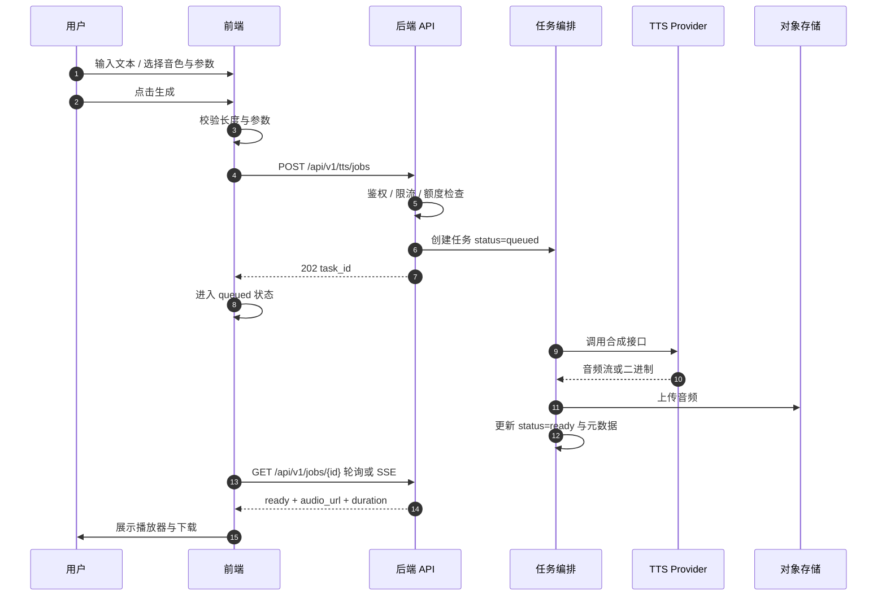

| 阶段 | 用户操作 | 前端状态 | 后端处理 | API | 成功 | 异常 |
|---|---|---|---|---|---|---|
| 输入 | 输入/粘贴 | 计数、校验 | 无 | 无 | 可生成 | 超限拦截 |
| 提交 | 点击生成 | 按钮 loading | 鉴权、限流、建任务 | `POST /tts/jobs` | 202 + id | 429 / 402 / 400 |
| 合成 | 等待 | 阶段文案 | 调 Provider、重试 1 次 | 内部 | 音频入库 | 记录失败原因 |
| 完成 | 播放/下载 | 播放器 | 签发 URL | `GET /jobs/{id}` | 可播放 | 文件缺失则重跑 |
| 重生成 | 改参数再生成 | 覆盖结果 | 新任务 | 同上 | 新音频 | 同上 |

### 7.2 录音转文本流程

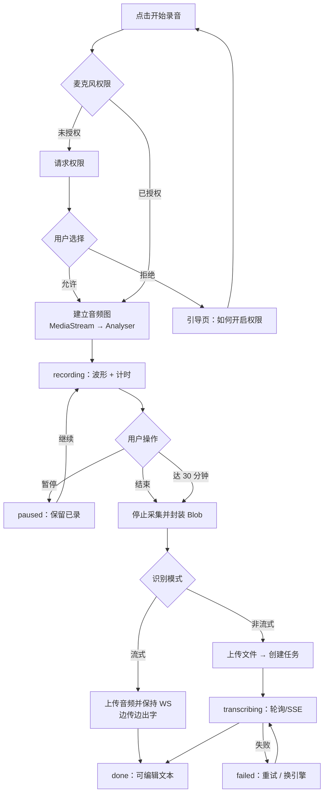

**录音状态机**

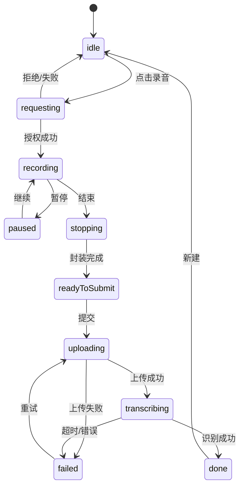

| 阶段 | 用户操作 | 前端状态 | 后端处理 | API | 成功 | 异常 |
|---|---|---|---|---|---|---|
| 录音 | 说 | 波形、计时 | 无 | 无 | Blob | 权限拒绝/设备占用 |
| 提交 | 点识别 | uploading | 校验、转码、建任务 | `POST /stt/jobs` | 202 | 413 / 415 |
| 识别 | 等 | transcribing | 调 Provider | `GET /stt/jobs/{id}` | 文本 | 超时 120s |
| 结果 | 编辑/复制/导出 | done | 无 | 无 | 导出文件 | 剪贴板失败降级 |

### 7.3 上传音频转文本流程

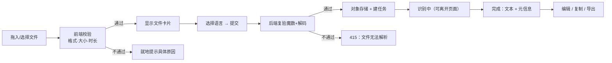

### 7.4 失败与降级流程

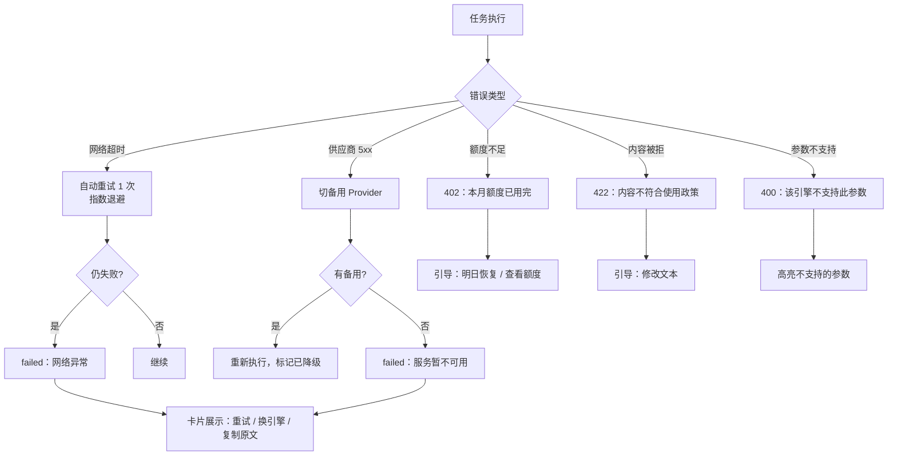

**原则**：任何失败都必须回答三件事——发生了什么、是否扣费、下一步做什么。

### 7.5 历史音频查看与下载

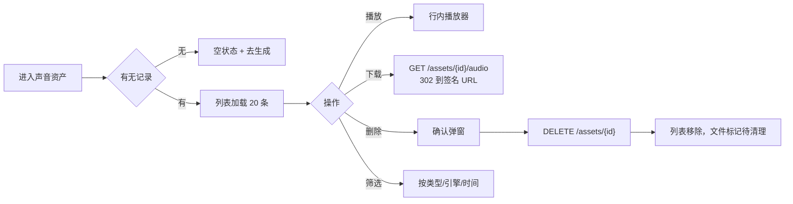

| 环节 | 说明 |
|---|---|
| 播放 | 复用播放器组件，`assets` 提供 URL 与 peaks |
| 下载 | 签名 URL 有效期 5 分钟，前端不持有永久链接 |
| 删除 | 软删 + 异步清理对象存储，24 小时内完成 |
| 留存 | 匿名会话 30 天；到期前 3 天在列表顶部提示 |

---

## 8. 开源语音模型调研

**调研日期：2026-10-31。** 许可证按「代码」与「权重」分列，因为两者常常不同——仓库公开不等于可以商用。

### 8.1 STT

| 模型 | 语言 | 中文 | 流式 | 硬件（参考） | 部署难度 | 代码许可 | 权重许可 | 商用 |
|---|---|---|---|---|---|---|---|---|
| Whisper large-v3 / turbo | 99 | 好 | ✗ 原生 | large ≈10GB；turbo ≈6–8GB 显存 | 低 | MIT | MIT | ✅ |
| faster-whisper | 同 Whisper | 好 | 伪流式（分段） | int8 量化可 CPU 跑 | 低 | MIT | MIT（继承） | ✅ |
| whisper.cpp | 同 Whisper | 好 | ✗ | CPU / Apple Metal，量化后 1–3GB | 低 | MIT | MIT | ✅ |
| FunASR（Paraformer） | 中英为主 | **很强** | ✅ 有流式模型 | 单卡 T4 足够；小模型 CPU 可跑 | 中 | MIT | **FunASR Model License** | ⚠️ 需读条款 |
| SenseVoice-Small | 中/粤/英/日/韩 | **很强** | ✗（非流式） | CPU 可跑，极快 | 中 | MIT | **FunASR Model License** | ⚠️ 需读条款 |

**逐项说明**

- **Whisper large-v3 / turbo**：识别鲁棒性最好的通用模型，口音、噪声、专有名词都稳；缺点是幻觉（静音段编造文本）和原生不支持流式。turbo 版把解码层从 32 降到 4，速度快 5–8 倍，是性价比首选。
- **faster-whisper**：CTranslate2 重实现，INT8 量化后 CPU 上也能接近实时，是「自托管批量转写」的默认选择。它不做真流式，但可用 1–2 秒分段模拟，延迟约 1.5–2.5s。
- **whisper.cpp**：纯 C/C++，无 Python 依赖，适合打包进桌面端或边缘设备；精度略低于 GPU 版，胜在部署极简。
- **FunASR**：阿里达摩院体系，Paraformer 在中文场景长期领先，标点、热词、时间戳都成熟，且有官方流式模型。**注意权重不是 Apache**，是 FunASR Model License，商用前必须逐条读。
- **SenseVoice**：极轻、极快（官方称比 Whisper-L 快 15 倍），附带情感与音频事件识别；只做识别不做流式。同样受 FunASR Model License 约束。

### 8.2 TTS

| 模型 | 语言 | 中文 | 自然度 | 速度 | 流式 | 克隆 | 硬件 | 部署难度 | 代码许可 | 权重许可 | 商用 |
|---|---|---|---|---|---|---|---|---|---|---|---|
| CosyVoice2-0.5B | 中英日韩粤等 | **很强** | 高 | 快 | ✅ 双向流式 | ✅ 零样本 | ≥8GB 显存 | 中 | Apache-2.0 | Apache-2.0 | ✅ |
| Qwen3-TTS（0.6B/1.7B） | 10 语言 | **很强** | 很高 | 很快（宣称首包 97ms） | ✅ | ✅ 含声音设计 | 6–12GB 显存 | 中 | Apache-2.0 | Apache-2.0 | ✅ |
| Kokoro-82M | 英日中等 | 中 | 中高（小模型里最好） | 极快，CPU 实时 | 分块 | ✗ | CPU 可跑 | 低 | Apache-2.0 | Apache-2.0 | ✅ |
| Fish Speech（S1/S2） | 13+ | 强 | 很高 | 中 | ✅ | ✅ 很强 | ≥8GB 显存 | 中 | 自定义 Fish Audio 许可（非 Apache） | CC-BY-NC-SA 4.0（s1-mini） | ❌ 默认不可商用 |
| Piper | 多语种（按 voice） | 中 | 中（偏机械） | 极快，CPU 实时 | 分块 | ✗ | 树莓派级 | 低 | MIT | **逐 voice 不同** | ⚠️ 逐 voice 核实 |

**逐项说明**

- **CosyVoice2-0.5B**：中文自然度与韵律在开源里第一梯队，支持零样本克隆、情感与方言指令，双向流式。0.5B 参数量对显存友好，是「自托管中文 TTS」的首选。
- **Qwen3-TTS**：2026 年 1 月开源，Apache 2.0，10 语言，支持声音设计与克隆，宣称首包 97ms。工程生态（vLLM、GGUF、MLX）跟进很快，是 CosyVoice 最强的竞争者。
- **Kokoro-82M**：8200 万参数，音质在小模型里异常能打，CPU 上可实时。没有克隆、语言覆盖有限，适合「提示音、固定播报、低成本场景」。
- **Fish Speech**：音质与克隆都很强，但许可证是**自定义的 Fish Audio 许可**（社区版与研究版并存），且 s1-mini 权重为 **CC-BY-NC-SA 4.0，明确非商用**。默认不可商用，除非拿到书面授权。这是本项目必须规避的坑——不要只看 GitHub 仓库公开就当成开源。
- **Piper**：极致轻量，适合离线和嵌入式；音质与 SOTA 有明显差距。代码 MIT，但**每个 voice 的许可不同**，有的仅限非商用，必须逐个核查。

### 8.3 结论

1. **可放心商用**的开源组合：`faster-whisper`（MIT）+ `CosyVoice2 / Qwen3-TTS`（Apache-2.0）。这是一条干净的路径。
2. **需要法务过一眼**：FunASR / SenseVoice（模型许可非标准开源）、Piper 的个别 voice。
3. **默认排除商用**：Fish Speech（权重 CC-BY-NC-SA 4.0，仓库为自定义许可）。除非获得书面授权，不进入任何商业链路。

---

## 9. 商业语音 API 调研

**调研日期：2026-10-31。价格随套餐与区域波动，签约前以官网为准；标注「待核实」的项未拿到官方页面原文。**

### 9.1 总览

| 供应商 | TTS 模型 | STT 模型 | 实时 | 中文 | 音色数量 | 免费额度 | Node SDK |
|---|---|---|---|---|---|---|---|
| OpenAI | gpt-4o-mini-tts、tts-1、tts-1-hd | gpt-4o-transcribe、mini、whisper-1 | STT 可近实时（realtime 系列） | 好 | 十余种内置音色 | 无长期免费额度 | ✅ 官方 `openai` |
| ElevenLabs | Eleven v4 / Flash / Turbo | Scribe v2 / Realtime | ✅ 双向流式 | 好 | 数千（含社区音色） | 免费档每月 1 万 credits | ✅ 官方 SDK |
| Google Cloud | Chirp 3 HD、Neural2、Standard | Chirp 3 / STT V2 | ✅ 流式 | 好 | 数百 | TTS 每月 400 万字符（Standard 档）；STT 每月 60 分钟 | ✅ `@google-cloud/*` |
| Azure Speech | Neural / HD | Speech to Text | ✅ 流式 | 好 | 500+（140+ 语种地区） | TTS 每月 50 万字符；STT 每月 5 小时 | ✅ `microsoft-cognitiveservices-speech-sdk` |

### 9.2 价格（美元，2026-10 公开价）

| 项目 | 单价 | 备注 |
|---|---|---|
| OpenAI tts-1 / tts-1-hd | $15 / $30 每百万字符 | 稳定、便宜、音色一般 |
| OpenAI gpt-4o-mini-tts | 约 $0.015/分钟音频 | 折合约 $15–17/百万字符（待核实折算） |
| OpenAI gpt-4o-transcribe | $0.006/分钟 | mini 版 $0.003 |
| OpenAI whisper-1 | $0.006/分钟 | 老模型，仍可用 |
| ElevenLabs TTS | 约 $0.10–0.22/千字符（按套餐） | Flash/Turbo 约半价；Creator $22/月含 10 万 credits |
| ElevenLabs Scribe | 约 $0.22–0.40/小时 | 待官网复核 |
| Google TTS Standard / Neural2 / Chirp 3 HD | $4 / $16 / $30 每百万字符 | 每月 400 万 Standard 字符免费 |
| Google STT | $0.016/分钟 | 每月 60 分钟免费 |
| Azure TTS Neural / HD | $16 / $30 每百万字符 | 每月 50 万字符免费 |
| Azure STT | $1/小时（约 $0.0167/分钟） | 每月 5 小时免费 |

### 9.3 并发与限制

| 供应商 | 并发 / 限流 | 说明 |
|---|---|---|
| OpenAI | 按账号 tier 限制 RPM/TPM | TTS 单请求文本上限约 4,096 字符；具体以账号 tier 为准 |
| ElevenLabs | 按套餐并发：Starter 约 3、Creator 约 5、Pro 约 10 | 并发数是 TTS 体验的硬约束，需提前确认（待核实） |
| Google | 按项目配额，默认较宽松 | 需申请提升 |
| Azure | 按资源层级（F0/S0） | S0 并发较高，需配额申请 |

### 9.4 各家的真实差异

- **OpenAI**：最省心，SDK 与文档质量最高，音色「干净但不够有戏」。适合 MVP 默认引擎。
- **ElevenLabs**：表现力与克隆最强，中文也自然；贵，且并发是硬门槛。适合「高质量档」而非默认档。
- **Google**：语种覆盖广、企业合规齐全，Chirp 3 HD 音质好；接入比 OpenAI 啰嗦，鉴权与配额配置成本高。
- **Azure**：语种最多（140+ 地区），SSML 控制最细，企业采购友好；音色偏「播音腔」，年轻化产品可能不喜欢。

### 9.5 数据与隐私（需逐家确认，不能假设）

| 问题 | 必须确认 |
|---|---|
| 是否用客户数据训练 | 合同层面排除，尤其 TTS 音色与 STT 音频 |
| 数据存储区域 | 是否可选 EU/US/APAC |
| 留存周期 | 音频与文本分别多久 |
| 删除机制 | API 是否支持主动删除 |
| 子处理者 | 清单与变更通知 |

> OpenAI、ElevenLabs、Google、Azure 的企业条款均可谈数据不训练，但**免费档与个人档往往条款不同**。MVP 若对外运营，至少要用付费档并留存条款截图。

### 9.6 国内可直连方案（v1.1 新增）

既然确定「大陆可直连」，默认链路就不能是 OpenAI / ElevenLabs——它们在大陆无法稳定直连。可选方案如下：

| 供应商 | TTS | STT | 计费方式 | 优势 | 注意 |
|---|---|---|---|---|---|
| **阿里云百炼** | CosyVoice 系列、Qwen3-TTS、托管 MiniMax | Paraformer、Qwen3-ASR | 按字符 / 按秒 / 按 token | 国内直连、中文最稳、与 OSS/ECS 同生态、发票齐全 | 不同模型计费单位不同，需分别核价 |
| **火山引擎** | 豆包语音合成 2.0、声音复刻 | 豆包语音识别 | 按字符 / 按并发 | 音色自然、方言与情感强、响应快 | 需商务开通，部分能力要报备 |
| **MiniMax** | speech 系列 | — | 按字符 | 音色表现力强、价格激进 | STT 能力需另配 |
| **讯飞开放平台** | 在线合成 | 语音听写 | 按次 / 资源包 | 老牌、行业方案成熟 | 接入方式偏传统，控制台体验一般 |

**计费量级（待核实，仅用于预算上限）**

| 项 | 公开档位参考 | 说明 |
|---|---|---|
| 阿里云 Paraformer 录音文件识别 | 约 ¥0.00008/秒（≈¥0.29/小时） | 秒级计费，长音频成本极低 |
| 阿里云 CosyVoice 合成 | 约 ¥1–3/万字符 | 按模型档位浮动 |
| 火山豆包 TTS | 约 ¥0.5–2/万字符 | 需商务报价 |
| MiniMax | 约 ¥0.1–0.5/千字符 | 档位差异大 |

> 以上单价来自公开渠道汇总，**本版未逐一核价**。技术评审前必须拿到至少两家正式报价单，否则成本模型不成立。

**对默认选型的影响**

| 能力 | v1.0 默认 | v1.1 默认（国内直连） |
|---|---|---|
| TTS | OpenAI gpt-4o-mini-tts | **阿里云 CosyVoice**（备选：火山豆包） |
| STT | OpenAI gpt-4o-transcribe | **阿里云 Paraformer / Qwen3-ASR**（备选：火山） |
| 海外访问 | — | 二期加香港/新加坡节点，区域隔离，音频不跨境 |
| 开源兜底 | CosyVoice 自托管 | 不变（同一模型，切换成本更低） |

---

## 10. 技术选型对比

### 10.1 三种方案

| 维度 | A 全开源自托管 | B 全商业 API | C 混合（推荐） |
|---|---|---|---|
| 初期开发成本 | 高（部署、推理服务、GPU 运维） | **低**（1–2 周接通） | 中（多一层适配，但本就该有） |
| 服务器成本 | $300–800/月起（GPU） | $0（按量） | $0–50/月（无 GPU） |
| API 使用成本 | 近似为 0（边际） | 按量，$15–220/百万字符 | 按量，可选低价档 |
| 运维复杂度 | 高（模型、显存、扩缩容） | **低** | 中低 |
| 语音质量 | 中–高（CosyVoice/Qwen3 很好） | **最高**（ElevenLabs） | 高 |
| 中文支持 | **很强**（FunASR/CosyVoice） | 好 | 强 |
| 延迟 | 取决于部署，可控 | 取决于网络，通常 200–600ms | 可控 |
| 可扩展性 | 受 GPU 限制 | 受配额限制 | 好 |
| 数据隐私 | **最好** | 依赖合同 | 好（敏感场景可切自托管） |
| 长期成本 | 量大后最低 | 随量线性增长 | 可优化 |
| 适合 MVP | ✗ | ✅ | **✅** |

### 10.2 推荐：方案 C，但按 B 的方式落地

**推荐理由**

1. MVP 只有 2–3 人，自建推理服务会吃掉一半工期，且质量不一定打得过商业 API。
2. 但「以后要换供应商」是必然事件（涨价、停服、合规），所以从第一天就要有 Provider 抽象——这本来就是 C 的核心，成本只是几个接口。
3. 落地形态：**商业 API 跑主链路，开源 Provider 代码写好、默认关闭**。等量起来或遇到合规要求，改一个配置就能切，不需要重构。

**具体选择**

| 能力 | 默认 | 备选 | 理由 |
|---|---|---|---|
| TTS | **阿里云 CosyVoice**（国内直连） | 火山豆包（音色更好）、ElevenLabs（海外高质量档）、CosyVoice2（自托管） | 便宜、稳定、中文自然、无跨境风险 |
| STT | **阿里云 Paraformer / Qwen3-ASR** | 火山豆包识别、faster-whisper（自托管）、Scribe v2（海外多语种） | 中文准确、按秒计价便宜、接入简单 |
| 长文本 | 分段 + 并发 3 | 顺序合成 | 控制并发与失败面 |

> 海外用户或海外合规需求出现时，切 OpenAI / ElevenLabs 只需改配置——这正是 Provider 抽象的价值。

**明确不选**：Fish Speech（权重非商用）、任何需要「先训练再能用」的方案（MVP 没有数据与算力）。

---

## 11. 推荐技术架构

### 11.1 系统架构

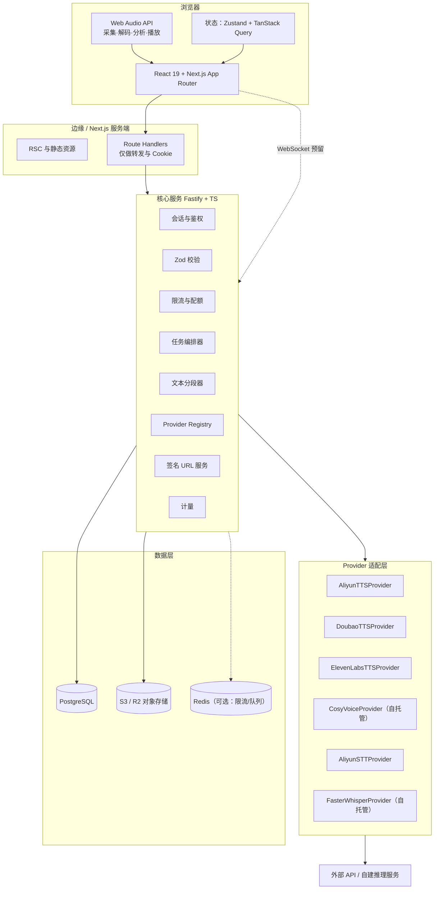

### 11.2 前端模块划分

```
app/
├── (marketing)/page.tsx          # 首页
├── studio/tts/page.tsx           # TTS 工作台
├── studio/stt/page.tsx           # STT 工作台
├── library/page.tsx              # 声音资产
├── settings/page.tsx
└── api/                          # BFF 转发（少量）

components/
├── voice-orb/                    # Canvas 声音球
├── waveform/                     # 波形（静态 peaks / 实时 analyser）
├── player/                       # 播放器
├── recorder/                     # 录音控件
├── config-panel/                 # 引擎与参数
├── asset-card/
└── ui/                           # 基础组件（Button/Select/Slider/Toast）

features/
├── tts/  hooks + state
├── stt/  hooks + state
├── assets/
└── engines/                      # 引擎能力查询与缓存

lib/
├── api-client.ts                 # 统一请求与错误映射
├── audio/                        # decode、peaks、recorder 封装
└── format.ts
```

**边界规则**：组件不直接 fetch；所有请求走 `features/*/hooks`；音频处理全部收口到 `lib/audio`，便于换实现。

### 11.3 后端模块划分

```
src/
├── server.ts               # Fastify 启动
├── plugins/                # cookie、cors、rate-limit、error-handler
├── routes/
│   ├── engines.ts
│   ├── voices.ts
│   ├── tts.ts
│   ├── stt.ts
│   ├── jobs.ts
│   └── assets.ts
├── modules/
│   ├── session/            # 匿名会话
│   ├── quota/              # 计量与限额
│   ├── jobs/               # 状态机、重试、清理
│   ├── segmenter/          # 长文本切分
│   └── storage/            # 对象存储、签名
├── providers/
│   ├── registry.ts
│   ├── types.ts
│   ├── tts/openai.ts
│   ├── tts/elevenlabs.ts
│   ├── tts/cosyvoice.ts
│   ├── stt/openai.ts
│   └── stt/faster-whisper.ts
└── db/  schema.ts + migrations
```

**框架选择**：MVP 用 **Fastify 5**。理由：路由与校验足够、插件生态成熟、启动快、TypeScript 体验好；NestJS 的 DI 与模块体系在 2–3 人团队里是额外的心智负担。若团队扩到 8 人以上、模块数翻倍，再评估迁移。

### 11.4 Provider 适配层（核心设计）

```ts
// 统一能力声明，前端据此渲染，不在业务层写 if
type TTSCapabilities = {
  streaming: boolean;
  pitch: boolean;
  volume: boolean;
  ssml: boolean;
  clone: boolean;
  maxCharsPerRequest: number;
  formats: Array<'mp3' | 'wav' | 'opus'>;
};

type TTSRequest = {
  text: string;
  voiceId: string;
  language?: string;
  speed?: number;
  pitch?: number;
  format?: 'mp3' | 'wav' | 'opus';
};

type TTSResult = {
  audio: Buffer | ReadableStream;
  format: string;
  durationMs?: number;
  sampleRate?: number;
};

interface TTSProvider {
  readonly id: string;              // "aliyun" | "doubao" | "openai" | ...
  readonly capabilities: TTSCapabilities;
  listVoices(language?: string): Promise<Voice[]>;
  synthesize(req: TTSRequest, signal?: AbortSignal): Promise<TTSResult>;
  synthesizeStream?(req: TTSRequest, signal?: AbortSignal): AsyncIterable<Uint8Array>;
}

type STTRequest = {
  audio: Buffer | ReadableStream;
  language?: string | 'auto';
  timestamps?: boolean;
  diarization?: boolean;
};

type STTResult = {
  text: string;
  language?: string;
  segments?: Array<{ text: string; startMs: number; endMs: number; speaker?: string }>;
  durationMs?: number;
};

interface STTProvider {
  readonly id: string;
  readonly capabilities: { streaming: boolean; diarization: boolean; timestamps: boolean; maxDurationSec: number };
  transcribe(req: STTRequest, signal?: AbortSignal): Promise<STTResult>;
  transcribeStream?(req: STTRequest, signal?: AbortSignal): AsyncIterable<Partial<STTResult>>;
}
```

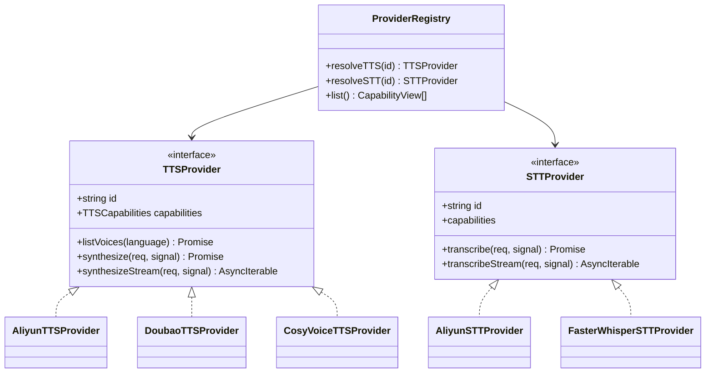

**三条硬规则**

1. 供应商错误在适配层被翻译成内部错误码，业务层不认识 `429`、`insufficient_quota` 这类外部词汇。
2. 缺少能力时**抛 `UNSUPPORTED_CAPABILITY`**，而不是静默忽略参数。
3. 每个 Provider 自带超时、重试、熔断配置，不写在业务逻辑里。

### 11.5 TTS 处理流程

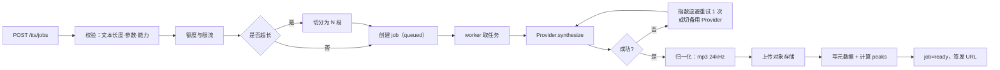

### 11.6 STT 处理流程

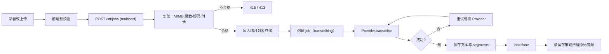

### 11.7 浏览器录音流程

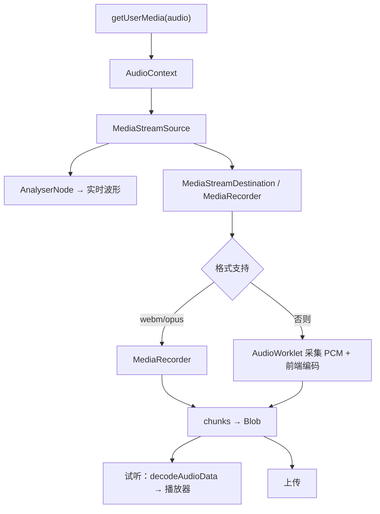

**关键点**：优先用 `MediaRecorder`（Safari 16.4+ 支持 `audio/mp4`），不可用时降级到 AudioWorklet 采 PCM + WAV 封装。录音时长与静音检测用 Analyser 的 RMS，不额外引入 VAD 库。

### 11.8 音频播放流程

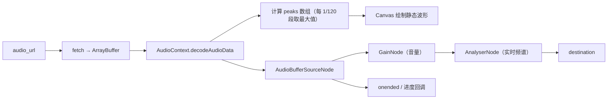

使用 `AudioBufferSourceNode` 而非 `<audio>` 标签，原因是：能精确 seek、能接 AnalyserNode、能统一倍速（`playbackRate`）。

### 11.9 文件存储设计

| 项 | 设计 |
|---|---|
| 存储 | S3 兼容（Cloudflare R2 优先，出网便宜） |
| Key 结构 | `audio/{yyyymm}/{sidHash}/{assetId}.mp3` |
| 访问 | 私有桶 + 5 分钟签名 URL，不暴露永久链接 |
| 生命周期 | 匿名资产 30 天；失败任务的临时文件 24 小时 |
| 元数据 | 时长、采样率、格式、字节数、peaks 文件（`{assetId}.peaks.json`） |
| 上传 | 后端流式写入，不落本地磁盘 |

### 11.10 错误处理机制

| 层 | 策略 |
|---|---|
| 前端 | 统一 `ApiError`，映射为可读文案 + 建议动作；网络错误可重试 |
| BFF | 透传 request_id，不吞错误 |
| 核心服务 | 领域错误码 + HTTP 状态 + `retryable` 布尔 |
| Provider | 超时 15s（TTS 首包）/ 90s（合成完成）/ 120s（STT）；最多重试 1 次 |
| 任务 | 状态机保证幂等；同一 job 不重复扣费 |
| 兜底 | 熔断后返回 `PROVIDER_UNAVAILABLE`，前端提示换引擎 |

**错误码表**

| code | HTTP | 含义 | 可重试 |
|---|---|---|---|
| `INVALID_ARGUMENT` | 400 | 参数不合法 | 否 |
| `TEXT_TOO_LONG` | 400 | 超长且未分段 | 否 |
| `UNSUPPORTED_CAPABILITY` | 400 | 引擎不支持该参数 | 否 |
| `UNAUTHORIZED` | 401 | 会话失效 | 否 |
| `QUOTA_EXCEEDED` | 402 | 额度不足 | 否 |
| `FORBIDDEN` | 403 | 无权访问该资产 | 否 |
| `NOT_FOUND` | 404 | 任务或资产不存在 | 否 |
| `PAYLOAD_TOO_LARGE` | 413 | 文件过大 | 否 |
| `UNSUPPORTED_MEDIA` | 415 | 音频无法解析 | 否 |
| `CONTENT_REJECTED` | 422 | 内容不符合政策 | 否 |
| `RATE_LIMITED` | 429 | 触发限流 | 是（退避） |
| `PROVIDER_TIMEOUT` | 504 | 供应商超时 | 是 |
| `PROVIDER_UNAVAILABLE` | 503 | 供应商不可用 | 是（换引擎） |
| `INTERNAL` | 500 | 未知错误 | 是 |

**统一响应体**

```json
{
  "error": {
    "code": "PROVIDER_TIMEOUT",
    "message": "语音服务响应超时，请稍后重试",
    "retryable": true,
    "requestId": "req_01J...",
    "details": { "provider": "openai" }
  }
}
```

---

## 12. UI/UX 设计规范

### 12.1 视觉方向

一句话：**深空里的声学仪器**。

不是黑底加霓虹，而是「精密设备」的质感——低饱和的深色、克制的光、极细的分隔线、只在高光处出现颜色。颜色永远服务于状态（正在听、正在合成），不做装饰性彩虹。

参考气质：Teenage Engineering 的工业感 + Linear 的克制 + 一点点天文馆的深邃。**明确避免**：紫蓝渐变铺满屏、玻璃拟态堆叠、发光边框卡片、AI 聊天框布局。

### 12.2 色彩系统

| Token | 值 | 用途 |
|---|---|---|
| `--bg-base` | `#07080C` | 页面底色 |
| `--bg-elev-1` | `#0D0F15` | 卡片、面板 |
| `--bg-elev-2` | `#14171F` | 悬浮层、下拉、播放器 |
| `--border-subtle` | `rgba(255,255,255,0.06)` | 分隔线、卡片描边 |
| `--border-strong` | `rgba(255,255,255,0.12)` | 聚焦、选中 |
| `--text-primary` | `#F4F5F9` | 标题、正文重点 |
| `--text-secondary` | `#A2A7B8` | 说明、次要信息 |
| `--text-tertiary` | `#6C7285` | 占位、禁用 |
| `--violet` | `#7C5CFF` | 主色、主按钮 |
| `--blue` | `#3D7BFF` | 次色、链接 |
| `--cyan` | `#22D3EE` | 强调、音频可视化 |
| `--success` | `#34D399` | 成功 |
| `--warning` | `#FBBF24` | 接近上限、待确认 |
| `--danger` | `#F87171` | 错误、删除 |

**使用比例**：背景与中性色 85%，主色 ≤10%，青色 ≤5%。**青色只能出现在「有声音」的地方**（波形、播放状态、录音电平），这条规则让视觉语言自洽。

主渐变仅用于 Logo 与声音球：`linear-gradient(135deg, #7C5CFF 0%, #3D7BFF 50%, #22D3EE 100%)`。

### 12.3 字体与层级

| 用途 | 字体 | 字号 / 行高 | 字重 | 字距 |
|---|---|---|---|---|
| 展示标题 | Geist / Inter | 56 / 64（移动 36/44） | 500 | -0.03em |
| 页面标题 | 同上 | 32 / 40 | 500 | -0.02em |
| 区块标题 | 同上 | 22 / 30 | 500 | -0.01em |
| 正文 | 同上 | 15 / 24 | 400 | 0 |
| 说明 | 同上 | 13 / 20 | 400 | 0 |
| 标签 | 同上 | 12 / 16 | 500 | 0.02em |
| 计时 / 数值 | JetBrains Mono | 14 / 20 | 500 | 0.04em（等宽对齐） |

中文回退链：`"Geist", "Inter", "Noto Sans SC", "PingFang SC", "Microsoft YaHei", sans-serif`。
**不引入衬线体**——会滑向「文艺播客」气质，与精密感冲突。数字与时长一律用等宽，避免跳动。

### 12.4 间距、圆角、描边、阴影

- 间距基数 4px，常用：4 / 8 / 12 / 16 / 24 / 32 / 48 / 64 / 96。
- 圆角：控件 10px，卡片 16px，面板 24px，药丸 999px。**不要所有东西都圆**——大面板 24 与控件 10 的对比是层次的一部分。
- 描边：默认 1px `--border-subtle`；聚焦时外扩 2px `rgba(124,92,255,0.35)`。
- 阴影只用三种：
  - `shadow-sm`: `0 1px 2px rgba(0,0,0,0.4)`
  - `shadow-md`: `0 12px 32px rgba(0,0,0,0.45)`
  - `glow`: `0 0 48px rgba(124,92,255,0.18)`（只给声音球与主按钮悬停）

### 12.5 栅格与响应式

| 断点 | 布局 |
|---|---|
| < 640 | 单列；播放器固定底部；配置抽屉从底部弹出 |
| 640–1024 | 单列 + 右侧配置折叠为抽屉 |
| 1024–1440 | TTS 双栏（编辑 1fr / 配置 340px） |
| ≥ 1440 | 内容最大宽 1320，两侧留白；TTS 双栏 + 底部常驻播放器 |

页面内边距：移动 16，平板 24，桌面 32。栅格 12 列、槽宽 24。

### 12.6 图标与插画

- 图标：Lucide，线性 1.5px，默认 20px，不加填充。**不用 emoji 当图标**。
- 空状态：不用通用「文件夹」插画，用一段静态波形 + 一句话，保持同一套视觉语言。
- 加载：不用三点跳动，用一条缓慢流动的细线（与声音主题一致）。

> 可交互高保真原型：`aural-prototype-v2.html`（首页 / TTS / STT / 资产四视图，含 WebGL 着色器球体、真实音频驱动的径向频谱、录音状态机）。v1 保留作对比。原型用于评审视觉与交互，数值以本章为准。

### 12.7 组件规范

| 组件 | 尺寸 | 状态 | 规范 |
|---|---|---|---|
| 主按钮 | 高 46 / 小号 34，圆角 12 / 9 | 默认、悬停、按下、禁用、加载 | 渐变底；悬停亮度 +6%；按下 `scale(.98)`；禁用透明度 .45；加载时文案替换为「生成中…」并锁宽 |
| 次按钮 | 同上 | 同上 | 透明底 + 1px 边框；悬停底色 4% 白 |
| 文本按钮 | 高 28 | 悬停、禁用 | 12.5px，悬停 8% 底色，圆角 7 |
| 输入框 | 高 40，内边距 12 | 默认、聚焦、错误、禁用 | 聚焦：边框 50% 紫 + 3px 光晕；错误：边框红 + 下方 12px 说明 |
| 文本域 | 自适应，最小 6 行 | 同上 | 无边框，行高 1.75；滚动条 6px |
| 下拉 | 高 34 | 默认、展开、禁用 | 菜单 `--e2` + `shadow-md`；项高 34，选中左侧 2px 紫条 |
| 滑块 | 轨道 3，拇指 14 | 默认、拖动、禁用 | 已选段紫色；拖动时数值等宽跟随；禁用透明度 .35 |
| 标签 | 高 22 | — | 11px，边框 `--line2`，圆角 999 |
| Toast | 自适应，最大 360 | 出现、消失 | 底部居中，距底 24；240ms 进出；2.2s 自动消失；不阻挡点击 |
| 提示 | 12px | 悬停 400ms 后出现 | 深色气泡 + 1px 边框，不用箭头 |
| 弹窗 | 最大 480，圆角 24 | 打开、关闭 | 遮罩 `rgba(0,0,0,.62)` + 8px 模糊；焦点锁定；Esc 关闭 |
| 骨架屏 | 随容器 | 仅 >300ms 加载显示 | 1.6s 微光扫过，避免闪烁 |
| 标注胶囊 | 高 36，圆角 999 | 默认、悬停、展开 | 锚在球体右上外侧 `right: -clamp(140px,13vw,224px)`；迷你球 21px（同主球色系，4.4s 呼吸）；音色名 12.5px/500 `#F2F3F8`；1px 分隔线；档位 9.5px 等宽、字距 .16em、52% 白；渐变底 + 内高光 `rgba(255,255,255,.06)` + 投影，悬停只加亮描边与紫色外环，不位移；展开时箭头旋转 180° |
| 选择浮层 | 宽 322（窄屏 `min(340, 100vw-32)`），圆角 18 | 关闭、展开、窄屏锚定 | 220ms 淡入 + 6px 上浮；背景 97% 不透明 + 22px 模糊；Esc/点外关闭 |
| 音色行 | 高 38 | 默认、悬停、选中、聚焦 | 选中为紫边 + 10% 底；右侧 24px 试听按钮；键盘 Enter/Space 选中 |

**统一规则**：所有可点击元素有 `:focus-visible` 环；所有异步动作有 loading 态；所有破坏性操作需二次确认。

### 12.8 状态与反馈矩阵

| 页面 | 空状态 | 加载中 | 失败 | 离线 |
|---|---|---|---|---|
| 首页最近记录 | 整块隐藏，不留空框 | 骨架 3 张卡片 | 隐藏并静默重试 | 保留缓存，顶部细条提示 |
| TTS | 编辑器占位文案 + 生成禁用 | 六阶段状态条，不用假百分比 | 状态条变红 + 重试/换引擎 | 保留文本，提示「网络已断开」 |
| STT | 声音球静止 + 「点击开始录音」 | 录音中波形 / 识别中环形流动 | 红色细环 + 重试 | 录音继续，提交时提示 |
| 资产 | 一行说明 + 「去生成第一条」 | 骨架 5 行 | 整页错误 + 重试 | 显示缓存列表，标注可能过期 |
| 设置 | — | — | — | — |

**文案原则**：说「怎么办」，不说「哪里错了」。示例：
- 好：「麦克风被其他应用占用，请关闭后重试」
- 差：「NotReadableError: Could not start audio source」

### 12.9 移动端细则

| 项 | 规范 |
|---|---|
| 底部安全区 | 播放器与操作条 `padding-bottom: env(safe-area-inset-bottom)` |
| 触控目标 | ≥44×44；音色卡片整行可点，不只有播放按钮 |
| 键盘 | 输入时播放器上移，不被键盘遮挡；`visualViewport` 监听 |
| 滚动 | 录音舞台不在移动端 sticky，避免占屏 |
| 手势 | 不引入自定义滑动手势（与浏览器返回冲突） |
| 横屏 | 录音舞台压缩到 40vh，结果区优先 |

### 12.10 视觉参考与取舍（v1.2）

设计前调研了 GitHub 上可参考的开源项目，只取「机制」，不照搬「皮肤」。

| 参考 | 学到什么 | 用在何处 |
|---|---|---|
| [pin-art-visualizer](https://github.com/wyattmattoe/pin-art-visualizer) | 用 9,424 个实例化针脚被 FFT 推动，把声音变成实体形变 | 确立「声音必须驱动几何」的原则；我们用 shader 实现同类体积感，避免上万实例的性能开销 |
| [kuhung/audiovisualizer](https://github.com/kuhung/audiovisualizer) | 球体 + 水波纹的边缘光与反射 | 球体的 rim light、内部色团与左上高光 |
| [audioMotion-analyzer](https://github.com/hvianna/audioMotion-analyzer) | 高分辨率频谱、对数频率映射、径向布局 | 播放器的 64 段径向频谱与对数取样 |
| [butterchurn](https://github.com/jberg/butterchurn) | Milkdrop 式「画面随低频呼吸」的反馈感 | 舞台背景光晕随低频缩放，而非随机闪烁 |
| [wavesurfer.js](https://github.com/katspaugh/wavesurfer.js) | 波形导航的手感：悬停气泡、点击跳转、播放头 | 波形带的 seek 交互与时间气泡 |
| [Bruno Simon 作品集](https://bruno-simon.com/) | 网页作为一件作品，单一主角、克制动效 | 首页只留一个焦点，其余全部退后 |
| [exprmntl/orb-ui](https://github.com/exprmntl/orb-ui) | 语音 Agent 的球体状态机：idle / listening / thinking / speaking | 首页球体的三态与状态文案 |
| [ElevenLabs UI](https://github.com/elevenlabs/ui) | 官方 Agent 组件库里没有「进入」按钮，交互直接发生在波形/球体上 | 删除首页所有 CTA |
| [LocalMode voice-button](https://registry.directory/LocalMode-AI/LocalMode/ui/audio/voice-button) | hold-to-record 的按住/松开时序与取消手势 | 按住说话、松开识别、短按提示 |
| [beUI voice-orb](https://beui.dev/components/agents/voice-orb) | 音频反应球体的亮度与半径映射 | 球体随音量增亮、外环频谱幅度 |
| [ElevenLabs Voice Picker](https://ui.elevenlabs.io/docs/components/voice-picker) | 音色列表必须带试听与标签，否则用户无法决策 | 浮层里的 2.5s 试听与「女 · 温和」标签 |
| [Vercel ai-elements VoiceSelector](https://elements.ai-sdk.dev/components/voice-selector) | 选择器作为可组合的对话框，触发器与内容分离 | 标注标签（trigger）与浮层（dialog）的分离 |

**取舍原则**

1. 不引入 three.js / GSAP：MVP 只需要一个全屏 quad 的 fragment shader，引入场景图是负优化。生产实现若需要多场景，再评估 R3F，shader 逻辑可直接迁移。
2. 不为「炫」牺牲可读性：所有装饰动画在 `prefers-reduced-motion` 下停止；青色的使用仍然只跟声音有关。
3. 任何可视化都必须有真实数据源（FFT、峰值、音量），**禁止用随机数伪造频谱**——这是这类产品最容易失信的地方。

---

## 13. 页面结构与原型说明

### 13.1 首页

```
┌──────────────────────────────────────────────────────────────┐
│  ◈ 声屿        TTS    STT    声音资产              设置  ⌘K  │
│                                                              │
│  ● SYSTEM ONLINE                    44.1 kHz · 24 bit · ZH/EN  │
│                                                              │
│                    AI VOICE STUDIO                           │
│                                                              │
│                 让文字，拥有声音                               │
│                 让声音，重新成为文字                           │
│                                                              │
│                        ╭──────────────╮                      │
│                        │ ◉ 晴川 │ 标准 ⌄ │ → 球体即控件；      │
│                        ╰──┬───────────╯   右上标注可点        │
│                       ╭───┴──────╮                           │
│                       │    ◉     │                           │
│                       ╰──────────╯                           │
│                                                              │
│                ● 按住圆球，说一句话                           │
│                                                              │
│                  或者，输入文字                                │
│                                                              │
│  ↓ 最近使用                       12 语言 · 24 音色            │
└──────────────────────────────────────────────────────────────┘
```

**设计要点（v1.3 重做：语音优先）**

- **首页没有任何按钮。** 球体就是唯一的控件：`pointerdown` 开始聆听，`pointerup` 结束并识别。这是 orb-ui、ElevenLabs UI、LocalMode voice-button 共同的范式——语音产品的首页应该让人直接说话，而不是先点一个「进入」。
- **产品在首页就能用，而且是完整闭环。** 按住说话 → 出文字 → **按 Enter，球体把这段文字读出来**；不跳转页面。文字输入同样在球体下方完成，回车即朗读。
- **球体是双向的**：语音进（麦克风）、语音出（TTS），视觉反馈都在同一个位置。这是本产品与「工具站」的根本区别。
- 四类状态见下方状态机。
- 球体由 WebGL fragment shader 实时渲染（fbm 噪声 + 边缘光 + 鼠标视差），尺寸 `min(640px, 76vw, 54vh)`，用视口高度封顶。
- 文字输入是**次要入口**：一条文字链接展开下划线输入框，不占视觉层级，也不与球体争夺注意力。
- **禁止 hover 位移与磁吸。** 所有可点击元素只做颜色、描边、透明度变化——元素在鼠标靠近时移动会让人误以为它在躲，这是廉价感的来源。
- **音色与引擎是球体的标注，不是新的一行 UI。** 球体**右上 2 点钟方向**，胶囊整体外移到球体外侧（`right: -clamp(140px, 13vw, 224px)`，与球体之间留出 30–90px 空气，不压住刻度环），再由一根自适应长度的斜引线（-15°，`width: out - 118px`，向右上淡出）连回球体：左侧 21px 迷你球（与主球同色系、缓慢呼吸）→ 音色名 12.5px → 1px 分隔线 → 质量档位（等宽 9.5px，全大写）→ 折叠箭头（展开时旋转 180°）。胶囊用上深下浅的渐变底 + 内高光 + 外投影，是一条「仪器铭牌」而不是一个网页按钮。点击在胶囊下方展开 322px 浮层，内含音色列表（2.5 秒试听 + 风格标签）与引擎切换。引擎名只出现在浮层里，普通用户看到的是「标准 / 高清」。
- 为什么是**右上**：左上与标题的第二行、副标题同处一条阅读线，会割裂文字块；右上落在球体的空旷侧，不碰标题也不压住操作提示，视线从标题下来刚好扫到。
- 为什么**不放在球体下方**：会新增第二条视觉重心、挤掉操作提示，并把首屏高度撑破；标注式不改变任何垂直节奏，选择器成为球体的属性。
- 选择后标签立即更新，球体色相做 ±8° 偏移，给「换了声音」一个非文字反馈。
- 移动端：标签移到球体上方（静态流，去掉引线），浮层锚定在标签正下方居中（宽 `min(340px, 100vw-32px)`）。不用 `position:fixed` 底部抽屉——首屏容器带入场 `transform` 动画，会成为 fixed 后代的包含块，抽屉会被顶到首屏底部之外。
- 顶部一行仪器化元信息与底部统计数字，用来建立「设备感」而不是营销感。
- 最近记录放在第二屏，滚动进入时淡入；首屏不出现任何列表。
- 自绘光标（圆点 + 延迟跟随的圆环）仅在首次移动鼠标后出现，避免静态首屏多出一个悬浮圆点。

**球体状态机（v1.4）**

| 状态 | 触发 | 视觉 | 提示文案 | 退出 |
|---|---|---|---|---|
| idle | 默认 | 缓慢呼吸、淡刻度环、外环微光 | 按住圆球，说一句话 | pointerdown / Enter（有文本时） |
| listening | pointerdown | 麦克风 FFT 外环、球体增亮、计时 | 正在聆听 · 0.0s | pointerup |
| thinking | 松开且时长 ≥0.45s | 紫色呼吸、外环静止 | 正在识别 | 1.1s 后自动进入结果态 |
| speaking | 回车 / 有文本时按 Enter | 声呐扩散环 + 球体脉冲 | 正在朗读 · Enter 停止 | 朗读结束 / 再按一次 / 点击球体 |

**关于「朗读」的可视化**：原型用浏览器 `SpeechSynthesis` 发声，它的输出无法接入 Web Audio，因此声呐环由 `onboundary`（词边界事件）+ 衰减包络驱动，**属于事件驱动的装饰动画，不是频谱**。生产实现必须改为：后端返回音频 → `AudioBufferSourceNode` → `AnalyserNode` → 用真实 FFT 驱动外环，与 TTS 工作台的播放器保持一致。

### 13.2 TTS 工作台

```
┌──────────────────────────────────────────────────────────────────────┐
│  文字转语音                          引擎 [阿里云 CosyVoice ▾]  生成  │
├───────────────────────────────────────────────┬──────────────────────┤
│  文本                                          │  语音配置             │
│  ┌─────────────────────────────────────────┐  │  语言  [中文 ▾]      │
│  │ 在这里输入或粘贴文本…                    │  │                      │
│  │                                         │  │  音色                │
│  │                                         │  │  ┌────────────────┐  │
│  │                                         │  │  │ ● 晴川  女·温和 │▶ │
│  └─────────────────────────────────────────┘  │  │ ○ 沉舟  男·低沉 │▶ │
│                                    0 / 5,000  │  └────────────────┘  │
│  [ 清空 ]  [ 粘贴示例 ]                        │  语速  ──●──── 1.0  │
│                                               │  音调  ────●── 0    │
├───────────────────────────────────────────────┴──────────────────────┤
│  ╭────╮  晴川 · 中文女声  00:12                    READY   1.0x  ↓    │
│  │ ◜◝ │  ALIYUN COSYVOICE · MP3 · 24kHz                              │
│  │ ▶  │  ▁▂▃▅▇▅▃▂▁▂▃▅▇▅▃▂▁▂▃▅▇▅▃▂▁                                   │
│  ╰────╯  00:00 ───────────────────────────────────────────── 00:12   │
└──────────────────────────────────────────────────────────────────────┘
```

**布局决策（v1.2 调整）**：编辑器占主视野（约 62%），配置在右栏固定 340px；播放器**不再是底部细条，而是一个独立的音频舞台**，横跨左栏整宽。原因：底部细条的波形只有 44px 高，视觉上无法承载「声音」这个主角；改成舞台后，径向频谱、波形带、标题与控制有了完整的层级。

**播放器规范**

| 元素 | 规格 |
|---|---|
| 径向频谱 | 64 个频段，内半径 30、外半径 56（118×118 画布），由真实 `AnalyserNode` 驱动 |
| 波形带 | 160 根镜像柱，已播部分用青→紫渐变，未播 16% 白；播放头带 28px 光晕 |
| 悬停 | 波形上方显示时间气泡，跟随鼠标；点击任意位置跳转 |
| 播放按钮 | 48px（移动 46），叠在频谱圆心，播放时切换为暂停 |
| 状态标签 | `QUEUED / PROCESSING / READY / PLAYING / PAUSED`，等宽小字，不用中文长句占位 |
| 音频 | 必须用 Web Audio `AudioBufferSourceNode` + `AnalyserNode` 真实播放，**可视化由真实 FFT 驱动**，禁止用随机数伪造频谱 |
| 空态 | 播放器始终存在但整体降透明度，显示「生成后在这里试听」，不做突然出现的布局跳动 |

**交互细节**

- 生成快捷键 `⌘/Ctrl + Enter`；输入框内不拦截其他快捷键。
- 生成中：编辑器出现旋转的渐变描边 + 自上而下的扫描线；文本仍可编辑，不打断任务。
- 音色卡片悬停 200ms 后出现试听按钮；试听时该卡片显示动态电平。
- 生成完成后：结果卡片以 `max-height + opacity` 展开，移动端自动滚动到播放器（`scrollIntoView({block:'center'})`）。
- 播放时整块舞台的背景光晕随低频能量缩放（`scale 1→1.12`），这是「炫」的来源，但它由真实音频驱动。
- 移动端：配置移到编辑器下方，播放器在生成后自动进入视野。

### 13.3 STT 工作台

```
┌──────────────────────────────────────────────────────────────────────┐
│  ← 返回     语音转文字               [ 录音 ] [ 上传文件 ]   [中文 ▾] │
├──────────────────────────────┬───────────────────────────────────────┤
│                              │  识别结果                              │
│         ╭──────────╮         │  ┌─────────────────────────────────┐  │
│         │          │         │  │ 今天的会议主要讨论了三件事…      │  │
│         │    ◉     │         │  │                                 │  │
│         │          │         │  │                                 │  │
│         ╰──────────╯         │  └─────────────────────────────────┘  │
│       ～～～ 波形 ～～～        │  1,284 字 · 03:12 · 用时 6.4s         │
│                              │                                       │
│          00:42               │  [ 复制 ]  [ 导出 TXT ]  [ 重新识别 ]  │
│                              │                                       │
│      [ 暂停 ]   [ 结束 ]      │                                       │
└──────────────────────────────┴───────────────────────────────────────┘
```

**设计决策**：录音舞台固定在左（宽 420–480，sticky），识别结果在右，方便「边说边看」与「录完立刻改」。移动端上下排列，舞台在上。

**六种状态的视觉**

| 状态 | 声音球 | 文案 | 主操作 |
|---|---|---|---|
| 等待 | 静止，低亮度 | 点击开始录音 | 开始 |
| 请求权限 | 缓慢收缩 | 正在请求麦克风权限 | — |
| 录音中 | 随音量脉动，外圈青色 | 正在录音 | 暂停 / 结束 |
| 暂停 | 停止脉动，外圈变灰 | 已暂停 | 继续 / 结束 |
| 识别中 | 环形流动（不确定态） | 正在识别… 已用时 3.1s | 取消 |
| 完成 | 回到静止，短暂高亮 | 识别完成 | 编辑 / 导出 |
| 失败 | 红色细环 | 识别失败：网络超时 | 重试 / 换引擎 |

**细节**：录音中麦克风被其他应用占用时，提示「麦克风被占用」并给出设备切换入口，不静默失败。

### 13.4 声音资产

列表而非卡片瀑布：这个页面是「管理」不是「浏览」，密度优先。

```
┌──────────────────────────────────────────────────────────────────────┐
│  声音资产                            [全部▾] [引擎▾] [时间▾]   🔍     │
├──────────────────────────────────────────────────────────────────────┤
│  ▶  产品介绍·女声        语音合成   阿里云·晴川   00:24   10-31 14:02│
│  ▶  会议记录 10-31       语音识别   阿里云       1,284字 10-31 11:20│
│  ▶  旁白 v2              语音合成   ElevenLabs   00:51   10-30 18:44│
├──────────────────────────────────────────────────────────────────────┤
│  匿名会话中保存，30 天后自动清理             [ 清空全部 ]             │
└──────────────────────────────────────────────────────────────────────┘
```

### 13.5 设置（轻量）

只有四项：默认引擎、默认音色、默认导出格式、数据清理。不做主题切换——产品只有一个主题，这也是品牌的一部分。

---

## 14. 动画设计规范

### 14.1 原则

1. **动画必须有信息**：要么表达状态（在听/在合成），要么表达空间关系（从哪来到哪去）。纯装饰只允许出现在首页背景。
2. **快于感知**：交互反馈 ≤120ms，状态切换 ≤240ms，入场 ≤600ms。
3. **不阻塞**：任何动画期间按钮可点，动画不接管输入。
4. **可关闭**：`prefers-reduced-motion: reduce` 时，装饰动画全部停止，功能动画降级为透明度变化。

### 14.2 动效清单与技术归属

| # | 动效 | 类型 | 技术 | 时长 / 曲线 | 说明 |
|---|---|---|---|---|---|
| 1 | 首页进入 | 装饰 | Framer Motion | 600ms，stagger 80ms | 标题→副标题→球→按钮依次上浮 16px |
| 2 | 页面切换 | 功能 | Framer Motion `AnimatePresence` | 240ms | 淡入 + 8px 位移；不用左右滑动，避免「像 PPT」 |
| 3 | 声音球呼吸 | 装饰 | WebGL fragment shader | 持续，正弦调制 | fbm 噪声位移 + 亮度呼吸；振幅由 `u_amp` 控制，录音/合成时增强 |
| 4 | 录音实时波形 | **真实音频** | Canvas + `AnalyserNode` | 60fps | RMS 平滑系数 0.8；30 根柱，按对数映射 |
| 5 | 生成时声波扩散 | 功能（状态） | CSS keyframes | 1.8s 循环，2 圈错峰 | 三层同心圆环，`scale 1→1.6`、`opacity .35→0` |
| 6 | 播放波形 | **真实音频** | Canvas + 预计算 peaks | 随播放进度 | 已播部分用青色，未播用 24% 白 |
| 7 | 状态过渡 | 功能 | Framer Motion `layout` | 320ms | 文案切换用 `AnimatePresence mode="wait"` |
| 8 | 音频卡片出现 | 功能 | Framer Motion | 320ms | `opacity 0→1`、`y 12→0`、`scale .98→1` |
| 9 | 按钮反馈 | 功能 | CSS | 120ms | `active: scale(0.98)`；主按钮悬停加 `glow` |
| 10 | 背景微粒 | 装饰 | Canvas 2D | 持续 | 桌面 40 粒、移动 15 粒；连线只在 120px 内 |
| 11 | 光幕转场 | 功能 | CSS 径向渐变 + JS 时序 | 190ms 进 / 340ms 出 | 从点击位置扩散；遮罩期间完成视图切换，避免闪烁 |
| 12 | 鼠标视差 | 装饰 | shader uniform + rAF | 持续 | 球体噪声域随鼠标偏移 ≤4.5%，不跟随光标做整体位移 |
| 13 | 径向频谱 | **真实音频** | Canvas + `AnalyserNode` | 60fps | 64 段、对数映射、smoothing 0.82 |
| 14 | 波形带 | **真实音频** | Canvas + 预计算 peaks | 随播放 | 160 根镜像柱；已播青紫渐变，播放头带光晕 |
| 15 | 自定义光标 | 装饰 | CSS transform + rAF 插值 | 持续 | 圆点即时、圆环延迟 0.16；首次移动鼠标后才出现；触控禁用 |
| 16 | 首页聆听频谱 | **真实音频** | Canvas + `AnalyserNode` | 60fps | 72 段外环，随麦克风能量增长；无麦克风时降级为模拟电平 |
| 17 | 转录打字机 | 功能 | JS 定时器 | 32ms/字 | 逐字输出 + 光标闪烁；识别完成后启动，可被下一次录音打断 |
| 18 | 提示点呼吸 | 装饰 | CSS keyframes | 2.8s | 仅待机态；聆听/识别时切换为实心发光点 |
| 19 | 朗读声呐环 | 装饰（事件驱动） | Canvas + `onboundary` | 每词一次脉冲 | 三圈同心扩散，周期 1.4s；脉冲幅度由词边界触发并指数衰减，不冒充频谱 |

### 14.3 真实可视化 vs 装饰动画

这是本产品最容易做假的地方，明确划线：

| 属于真实音频 | 属于装饰 |
|---|---|
| 录音时的电平与波形 | 首页声音球的呼吸 |
| 播放时的波形进度 | 生成时的扩散圆环 |
| 播放时的频谱条（如启用） | 背景微粒 |
| 录音计时 | 按钮光晕 |

**规则**：装饰动画不得暗示「有声音正在播放」。例如首页球在无音频时脉动幅度必须明显低于录音态，且不带青色。

### 14.4 性能预算与实现约束

| 项 | 约束 |
|---|---|
| 帧预算 | 每帧 JS ≤ 8ms；Canvas 绘制 ≤ 4ms |
| DPR | Canvas 上限 2，超过按 2 渲染再放大 |
| 粒子 | 桌面 ≤40，移动 ≤15；低端设备（`navigator.hardwareConcurrency ≤ 4`）再减半 |
| 降频 | `document.hidden` 时暂停所有 rAF；恢复时重置时钟 |
| 内存 | peaks 数组按 120 桶预计算，不每帧重算 |
| React | 波形进度用 ref 直接改 Canvas，不触发重渲染 |
| 图片/字体 | 字体子集化，`font-display: swap`；不加载动图 |
| WebGL | 单个全屏 quad + 5 层 fbm；DPR 上限 1.75；页面隐藏时停止渲染；无 WebGL 时降级为 CSS 径向渐变 |
| 频谱 | 64 段、512 点 FFT、平滑系数 0.82；每帧只读一次 `getByteFrequencyData` |

### 14.5 可访问性

- `prefers-reduced-motion: reduce`：停用 1、3、5、10；2、7、8 改为 120ms 透明度过渡；4、6 保留（它们是信息本身，但降低刷新率到 20fps）。
- 所有图标按钮有 `aria-label`；状态变化通过 `aria-live="polite"` 播报（录音中、识别完成、生成失败）。
- 颜色对比：正文 ≥ 4.5:1；`--text-tertiary` 只用于非关键信息。
- 焦点环始终可见，不用 `outline: none` 了事。
- 键盘可达：Tab 顺序 = 视觉顺序；播放器支持空格与方向键；模态框焦点锁定。

### 14.6 设计验收清单

评审与提测时逐项打勾，任何一项不过不进入开发验收。

| # | 检查项 | 标准 | 验证方式 |
|---|---|---|---|
| 1 | 色彩 token | 页面不出现规范外的色值；青色只出现在音频相关元素 | 全局搜索十六进制色值 |
| 2 | 字号层级 | 以 12/13/14/15/16/22/32/56 为骨架，组件内允许 ±0.5px 微调，不出现 18/20/24 等跳跃档 | 抽查 10 个文本节点 |
| 3 | 间距 | 所有间距为 4 的倍数 | 抽查关键容器 |
| 4 | 圆角 | 控件 10、卡片 16、面板 24，不混用 | 截图比对 |
| 5 | 状态覆盖 | 空 / 加载 / 成功 / 失败 / 禁用 五态齐全 | 逐页走查 |
| 6 | 加载时序 | 300ms 内不显示骨架，避免闪烁 | 弱网模拟 |
| 7 | 反馈时延 | 点击到视觉反馈 ≤120ms | 录屏逐帧 |
| 8 | 动画性能 | 桌面 ≥55fps、移动 ≥45fps；无 >50ms 长任务 | Performance 面板 |
| 9 | reduced-motion | 装饰动画停止，功能动画降级为透明度 | 系统设置切换 |
| 10 | 对比度 | 正文 ≥4.5:1，次要文字 ≥3:1 | 对比度工具 |
| 11 | 键盘 | 不用鼠标可完成一次 TTS 与一次录音提交 | 纯键盘走查 |
| 12 | 响应式 | 390 / 768 / 1024 / 1440 四档无横向滚动、无遮挡 | 设备模拟器 |
| 13 | 触控 | 所有可点区域 ≥44×44 | 移动端实测 |
| 14 | 文案 | 每条错误都能回答「发生了什么、怎么办」 | 随机抽 5 条错误 |
| 15 | 原型一致 | 实现与 `aural-prototype-v1.html` 的视觉差异仅限内容 | 并排比对 |

---

## 15. 数据模型设计

### 15.1 实体关系

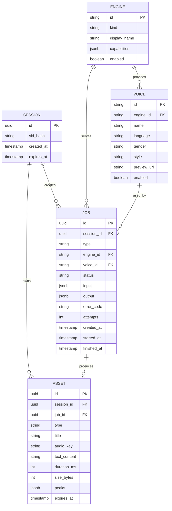

### 15.2 核心类型（TypeScript）

```ts
type EngineKind = 'tts' | 'stt';
type JobType = 'tts' | 'stt';
type JobStatus =
  | 'queued' | 'running' | 'succeeded' | 'failed' | 'cancelled' | 'expired';

interface VoiceEngine {
  id: string;                 // 'openai' | 'elevenlabs' | 'cosyvoice'
  kind: EngineKind;
  displayName: string;
  capabilities: {
    streaming: boolean;
    pitch: boolean;
    volume: boolean;
    ssml: boolean;
    clone: boolean;
    timestamps: boolean;
    diarization: boolean;
    maxCharsPerRequest?: number;
    maxAudioSeconds?: number;
    formats?: string[];
  };
  enabled: boolean;
}

interface Voice {
  id: string;                 // 引擎内唯一，如 'openai:alloy'
  engineId: string;
  name: string;
  language: string;           // BCP-47
  gender?: 'female' | 'male' | 'neutral';
  style?: string[];           // ['warm', 'narration']
  previewUrl?: string;
  enabled: boolean;
}

interface TTSJobInput {
  text: string;
  voiceId: string;
  language?: string;
  speed?: number;
  pitch?: number;
  volume?: number;
  format?: 'mp3' | 'wav' | 'opus';
  segments?: string[];         // 超长文本切分结果
}

interface STTJobInput {
  language?: string | 'auto';
  timestamps?: boolean;
  diarization?: boolean;
  audioKey: string;            // 已上传的临时对象
  durationMs?: number;
}

interface Job {
  id: string;
  sessionId: string;
  type: JobType;
  engineId: string;
  voiceId?: string;
  status: JobStatus;
  progress?: number;           // 0–100，仅供应商真实返回时有值
  stage?: string;              // 'queued' | 'synthesizing' | 'encoding' | 'transcribing'
  input: TTSJobInput | STTJobInput;
  output?: {
    assetId?: string;
    text?: string;
    segments?: Array<{ text: string; startMs: number; endMs: number; speaker?: string }>;
    durationMs?: number;
    language?: string;
  };
  error?: { code: string; message: string; retryable: boolean };
  createdAt: string;
  startedAt?: string;
  finishedAt?: string;
}

interface AudioAsset {
  id: string;
  sessionId: string;
  jobId?: string;
  type: 'tts' | 'stt';
  title: string;
  audioUrl?: string;           // 动态签发，不持久化
  textContent?: string;
  durationMs?: number;
  sizeBytes?: number;
  peaks?: number[];            // 120 个归一化峰值
  engineId: string;
  voiceId?: string;
  createdAt: string;
  expiresAt: string;
}
```

### 15.3 规则

1. `job.input` 用 JSONB 存原始参数，便于回放与复盘；敏感字段（无）单独处理。
2. `asset` 不存外部 URL，只存对象存储 key，URL 每次签发。
3. 删除为软删：`deleted_at` 置位 + 24 小时内异步清理对象。
4. 所有表带 `created_at`；`session` 过期由定时任务批量处理。
5. 不建 `user` 表——MVP 用 `session`，将来加 `user_id` 外键即可迁移。

---

## 16. API 接口设计

统一前缀 `/api/v1`。除下载跳转外，全部返回 JSON。

### 16.1 引擎与音色

| 方法 | 路径 | 说明 | 参数 | 返回 |
|---|---|---|---|---|
| GET | `/engines` | 可用引擎与能力 | `kind?` | `VoiceEngine[]` |
| GET | `/voices` | 音色列表 | `engineId`, `language?`, `q?` | `Voice[]` |
| GET | `/voices/:id/preview` | 音色试听 | — | 302 到音频 URL |

### 16.2 TTS

| 方法 | 路径 | 说明 |
|---|---|---|
| POST | `/tts/jobs` | 创建合成任务 |
| GET | `/jobs/:jobId` | 查询任意任务 |
| DELETE | `/jobs/:jobId` | 取消未完成任务 |

**POST /tts/jobs**

```json
// 请求
{
  "text": "让文字拥有声音。",
  "engineId": "openai",
  "voiceId": "openai:alloy",
  "language": "zh",
  "speed": 1.0,
  "format": "mp3"
}
```

```json
// 202
{
  "jobId": "job_01J9Z3K2",
  "status": "queued",
  "createdAt": "2026-10-31T06:12:03Z"
}
```

| 错误 | 触发 |
|---|---|
| `400 INVALID_ARGUMENT` | 参数校验失败 |
| `400 TEXT_TOO_LONG` | 超 5,000 字且未请求分段 |
| `400 UNSUPPORTED_CAPABILITY` | 引擎不支持 pitch/format |
| `402 QUOTA_EXCEEDED` | 当日额度用尽 |
| `429 RATE_LIMITED` | 每分钟任务数超限 |

**GET /jobs/:jobId**

```json
{
  "id": "job_01J9Z3K2",
  "type": "tts",
  "status": "succeeded",
  "stage": "encoding",
  "progress": null,
  "output": {
    "assetId": "ast_01J9Z4A1",
    "durationMs": 12400
  },
  "createdAt": "2026-10-31T06:12:03Z",
  "finishedAt": "2026-10-31T06:12:05Z"
}
```

> `progress` 为 `null` 表示供应商不提供真实进度。**前端不得据此推算百分比。**

### 16.3 STT

| 方法 | 路径 | 说明 |
|---|---|---|
| POST | `/stt/jobs` | `multipart/form-data`，字段 `file` + `language` |
| GET | `/jobs/:jobId` | 同上，`type=stt` |
| WS | `/stt/stream` | Phase 2，流式识别 |

**POST /stt/jobs**

| 字段 | 类型 | 必填 | 说明 |
|---|---|---|---|
| `file` | binary | 是 | ≤20MB，mp3/wav/m4a/aac/ogg/flac/webm |
| `language` | string | 否 | `zh` / `en` / `auto`，默认 `auto` |
| `timestamps` | boolean | 否 | 默认 false |
| `diarization` | boolean | 否 | 默认 false |

响应 202 与 TTS 同构，`output.text` 与 `output.segments` 在完成时返回。

### 16.4 资产

| 方法 | 路径 | 说明 |
|---|---|---|
| GET | `/assets` | 列表，`type?`、`engineId?`、`cursor?`、`limit=20` |
| GET | `/assets/:id` | 单个资产元数据 |
| PATCH | `/assets/:id` | 重命名 `{ title }` |
| DELETE | `/assets/:id` | 软删 |
| GET | `/assets/:id/audio` | 302 到 5 分钟签名 URL |
| GET | `/assets/:id/peaks` | 波形数据（缓存 1 天） |

### 16.5 会话与配额

| 方法 | 路径 | 说明 |
|---|---|---|
| GET | `/session` | 返回会话 ID、配额、到期时间 |
| DELETE | `/session/data` | 清空该会话全部资产 |

```json
{
  "sessionId": "ses_01J9...",
  "quota": { "ttsChars": { "used": 3200, "limit": 20000 },
             "sttSeconds": { "used": 180, "limit": 1800 } },
  "expiresAt": "2026-11-30T00:00:00Z"
}
```

### 16.6 状态定义

| 状态 | 含义 | 终态 |
|---|---|---|
| `queued` | 已入队，等待执行 | 否 |
| `running` | 执行中，`stage` 细分 | 否 |
| `succeeded` | 完成，`output` 可用 | 是 |
| `failed` | 失败，`error` 有值 | 是 |
| `cancelled` | 用户取消 | 是 |
| `expired` | 超时未完成（30 分钟） | 是 |

**轮询策略**：前端 1s 间隔，连续 5 次后降到 2s，60s 后 5s；页面隐藏时暂停轮询。Phase 2 可换 SSE，MVP 不引入。

---

## 17. 安全与隐私设计

### 17.1 密钥与代理

- 所有供应商 Key 只存在服务端环境变量（或密钥管理服务），**前端 bundle 中不得出现任何 Key 字符串**。
- 前端只与自家 API 通信；BFF 只做转发与 Cookie 处理，不落业务逻辑。
- CI 加一条检查：构建产物中 grep 供应商 Key 前缀，命中即失败。

### 17.2 数据流向

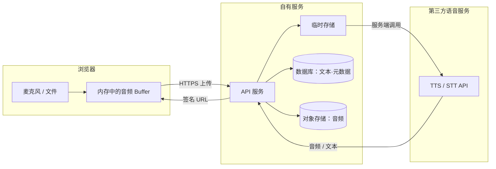

**三个环节的边界**

| 环节 | 数据形态 | 停留时间 | 风险控制 |
|---|---|---|---|
| 浏览器录音 | 内存 Blob | 会话内 | 不写 localStorage；关闭即释放 |
| 上传到自有服务 | 临时文件 | ≤24h（成功任务） | 私有桶、无公网读 |
| 送往第三方 | 音频流 / 文本 | 供应商政策决定 | 合同排除训练；优先选支持区域化的供应商 |

### 17.3 输入校验

| 项 | 前端 | 后端 |
|---|---|---|
| 文本长度 | 计数 + 拦截 | Zod 校验 ≤5,000 |
| 音频格式 | 扩展名 + MIME | 魔数校验 + 实际解码 |
| 文件大小 | ≤20MB | Content-Length + 流式计数 |
| 时长 | 解码后读取 | ffprobe 或解码器 |
| 文件名 | 过滤路径字符 | 不使用用户文件名做 key |

### 17.4 限流与额度

| 维度 | 默认 | 说明 |
|---|---|---|
| 单 IP 任务数 | 20/分钟 | 防刷 |
| 单会话 TTS | 20,000 字符/日 | 约 20 分钟音频 |
| 单会话 STT | 1,800 秒/日 | 30 分钟 |
| 单文件并发 | 1 | 同一会话同时只跑 1 个任务 |
| 全局并发 | 20 | 保护供应商配额 |

超限返回 `429`（带 `Retry-After`）或 `402`（额度用尽）。

### 17.5 资产访问控制

- 所有资产读取都校验 `session_id` 归属，禁止仅凭 ID 访问。
- 音频下载走 302 + 签名 URL（5 分钟），不返回永久地址。
- `peaks` 可缓存，但同样校验归属。
- 删除后立即不可访问，对象异步清理。

### 17.6 留存与删除

| 数据 | 留存 | 删除方式 |
|---|---|---|
| 匿名资产 | 30 天 | 到期批量清理 + 用户主动删除 |
| 失败任务音频 | 24 小时 | 定时清理 |
| 数据库元数据 | 同资产 | 软删后 7 天物理删除 |
| 日志 | 30 天 | 不含音频与完整文本 |

`DELETE /session/data` 需在 24 小时内完成对象清理，并向用户展示「已清理 N 项」。

### 17.7 声音克隆（Phase 3 前置要求）

MVP 不做，但架构要预留三条硬约束，写进 Provider 接口注释：

1. 克隆必须绑定**授权凭证**（授权人、范围、期限），无凭证不可创建。
2. 克隆音色输出必须携带 AI 生成标识（元数据 + 可选不可听水印）。
3. 授权到期或撤回，音色立即失效，历史音频不可再合成。

### 17.8 合规提示

- 若面向欧盟用户，AI 交互需告知、合成音频需可标识（EU AI Act 第 50 条，2026-08-02 起适用）。MVP 至少要做到：页面明确标注「AI 合成语音」，音频文件元数据写入生成标记。
- 不采集声纹、不做身份识别，避免落入生物识别特殊类别数据。

---

## 18. MVP 需求范围

### 18.1 必须交付（P0）

| # | 功能 | 关键验收 | 估时（人日） |
|---|---|---|---|
| 1 | 首页（声音球、双入口、最近记录） | 首屏可理解用途；LCP ≤2.5s | 4 |
| 2 | TTS 文本输入与校验 | 计数、超限、清空、粘贴 | 2 |
| 3 | 引擎/音色选择与试听 | 能力差异正确置灰 | 4 |
| 4 | 参数（语速）与生成 | 状态机完整；无假进度 | 4 |
| 5 | 音频播放器 | 波形、seek、倍速、下载 | 5 |
| 6 | 麦克风录音 | 权限、暂停/继续、计时、波形 | 6 |
| 7 | 音频上传 | 格式/大小/时长校验；服务端复验 | 3 |
| 8 | 识别与结果编辑 | 复制、TXT 导出、重试 | 4 |
| 9 | 声音资产列表 | 播放、下载、删除、空状态 | 4 |
| 10 | 会话与配额 | 匿名会话、日额度、429/402 | 3 |
| 11 | 全局状态与错误 | 所有失败有可执行提示 | 3 |
| 12 | 视觉与动效 | 设计规范落地；reduced-motion | 6 |
| 13 | 响应式 | 390px 可用 | 3 |

合计约 **51 人日**（不含设计）。2 人并行约 6–7 周。

### 18.2 可选（P1，时间允许才做）

- 长文本分段生成（TTS-IN-06）
- 音调/音量参数（TTS-CFG-06/07）
- 倍速与键盘快捷键
- 录音回放、设备切换
- 资产重命名与筛选
- 参数记忆

### 18.3 明确不做（本期）

| 不做 | 原因 |
|---|---|
| 注册登录、用户中心 | 匿名会话已够用，账号会拖慢 2 周 |
| AI 对话、AI 朗读 | Phase 2 |
| 声音克隆、多角色 | Phase 3，且需合规设计 |
| 实时流式 STT | 商业 API 支持，但前端状态机复杂度翻倍 |
| SRT/VTT 导出 | 依赖时间戳质量，Phase 2 |
| 付费订阅、额度购买 | 无账号体系时无意义 |
| 团队空间、权限 | 非目标用户 |
| 暗色/亮色切换 | 单主题是品牌决策 |

### 18.4 范围护栏

评审时若有人提出「顺手加个 XX」，判断标准只有一条：**它是否让首次成功生成变得更慢或更绕**。是，则拒绝。

---

## 19. 项目开发计划

### 19.1 团队与分工

| 角色 | 人力 | 职责 |
|---|---|---|
| 前端 | 1 | Next.js、组件、音频、动效 |
| 全栈/后端 | 1 | Fastify、Provider、存储、部署 |
| 设计 | 0.3 | 设计规范、关键页高保真 |
| 测试 | 0.3 | 用例、兼容性、验收 |

### 19.2 阶段划分

| 阶段 | 周期 | 交付物 | 出口标准 |
|---|---|---|---|
| S0 基建 | 1 周 | 仓库、CI、设计 token、Provider 接口、OpenAI 接通 | 一条 TTS 命令能出音频 |
| S1 TTS 闭环 | 2 周 | 编辑器、配置、任务、播放器、下载 | 真实用户可用；状态机无死锁 |
| S2 STT 闭环 | 2 周 | 录音、上传、识别、结果编辑 | 录音 30 分钟不崩；上传校验完整 |
| S3 资产与打磨 | 1.5 周 | 资产库、配额、错误体系、动效 | 验收清单 90% 通过 |
| S4 硬化与发布 | 1 周 | 性能、可访问性、兼容性、监控 | 第 20 章全部达标 |

**总计约 7.5 周**（含缓冲）。设计需在 S0 结束前完成首页与两个工作台的高保真。

### 19.3 技术风险（开发视角）

| 风险 | 触发信号 | 应对 |
|---|---|---|
| Web Audio 在 Safari 上行为差异 | iOS 首次播放无声 | 统一在用户手势后 `resume()`；准备 `<audio>` 兜底路径 |
| MediaRecorder 格式不统一 | Safari 输出 mp4、Chrome 输出 webm | 服务端统一转码；前端声明实际 MIME |
| 长文本合成超时 | 5,000 字单请求 >90s | 分段 + 并发 3；单段失败只重跑该段 |
| 供应商限流 | 429 集中出现 | 队列削峰 + 退避 + 备用 Provider |
| Canvas 动画掉帧 | 低端机 <30fps | 粒子减半、DPR 降级、隐藏时暂停 |
| 匿名会话丢失 | 用户清 Cookie 后资产消失 | 明确提示；不做「找回」承诺 |

### 19.4 部署（v1.1 按「国内直连」调整）

| 层 | 选型 | 说明 |
|---|---|---|
| 前端 | 阿里云 ECS / SAE，或函数计算 | 需 Node runtime 支持 Route Handlers；不用 Vercel（大陆访问不稳） |
| 后端 | 阿里云 ECS 单实例容器起步 | 预留水平扩展；与前端同 VPC |
| 数据库 | 阿里云 RDS PostgreSQL | 托管备份；不用 Neon/Supabase |
| 对象存储 | 阿里云 OSS | 私有桶 + 签名 URL；音频境内存储 |
| CDN | 阿里云 CDN | 静态资源加速 |
| 监控 | 结构化日志 + Sentry（国内可用节点） | 不上 Prometheus 全家桶 |

**必须提前处理的合规项**

1. **ICP 备案**：域名与服务器均需备案，周期通常 1–3 周，属于排期前置项，不能等上线前才办。
2. **公安备案**：网站上线后 30 日内完成。
3. **个人信息保护**：音频属个人信息，需在隐私政策中说明收集目的、留存期限与删除方式。
4. **算法备案/深度合成**：若后续上线合成语音对外服务，需评估《互联网信息服务深度合成管理规定》的标识与备案要求；MVP 阶段至少在界面与音频元数据中标注「AI 合成」。
5. **数据出境**：二期做海外节点时，按区域隔离存储，避免音频跨境传输。

---

## 20. 验收标准

### 20.1 功能

| 项 | 通过条件 |
|---|---|
| TTS 生成 | 合法输入下成功率 ≥99%（100 次连续测试） |
| TTS 长文本 | 5,000 字全流程完成率 ≥95%，无截断 |
| STT 录音 | 30 分钟录音可完整提交并返回结果 |
| STT 上传 | 7 种格式各 1 个样本全部成功；伪造扩展名被拒 |
| 播放器 | seek 误差 ≤0.2s；倍速切换不断音 |
| 下载 | 文件名规范；音频可被系统播放器打开 |
| 失败处理 | 每个错误码都有对应文案与下一步动作 |
| 资产 | 删除后立即不可访问；刷新后列表一致 |

### 20.2 性能

| 指标 | 目标 | 测量 |
|---|---|---|
| LCP | ≤2.5s（4G 模拟） | Lighthouse |
| INP | ≤200ms | 实测 |
| CLS | ≤0.1 | Lighthouse |
| 首屏 JS | ≤250KB gzip | 构建产物 |
| TTS 首帧音频（<200 字） | p50 ≤1.5s，p95 ≤3s | 100 次采样 |
| TTS 5,000 字 | p95 ≤60s | 20 次采样 |
| STT 30 分钟音频 | p95 ≤180s | 10 次采样 |
| 动画帧率 | 桌面 ≥55fps，移动 ≥45fps | 录制 + 帧分析 |
| 录音启动 | 点击到 recording ≤500ms | 手动计时 |

### 20.3 体验

| 项 | 通过条件 |
|---|---|
| 状态可见 | 录音五态、生成六态都有独立视觉，用户测试能说出当前状态 |
| 反馈及时 | 所有点击 120ms 内有视觉反馈 |
| 错误可懂 | 5 位非技术用户能复述「发生了什么、下一步做什么」 |
| 移动端 | 390×844 下无横向滚动；播放器不遮挡输入 |
| 可访问性 | 键盘可完成一次完整 TTS；对比度达标；reduced-motion 生效 |
| 视觉一致性 | 同一组件在不同页面无样式漂移 |

### 20.4 上线检查清单

- [ ] 环境变量齐全，构建产物无 Key
- [ ] 限流与额度生效
- [ ] 删除与留存任务已调度
- [ ] 监控与告警接入
- [ ] 隐私说明与 AI 合成标识上线
- [ ] 回滚方案演练一次

---

## 21. 风险分析

| ID | 风险 | 概率 | 影响 | 应对 |
|---|---|---|---|---|
| R1 | 供应商涨价/停服 | 中 | 高 | Provider 抽象 + 第二家已接通但默认关闭 |
| R2 | 语音质量不达预期（尤其中文） | 中 | 高 | S0 就做 3 家 A/B 盲测，早定默认引擎 |
| R3 | 长文本合成成本失控 | 中 | 中 | 分段 + 缓存固定话术 + 日额度 |
| R4 | Safari/iOS 音频兼容问题 | 高 | 中 | 早期真机测试；准备 `<audio>` 兜底 |
| R5 | 设计过度导致工期膨胀 | 中 | 中 | 动效清单冻结，超出范围的动画进 backlog |
| R6 | 匿名会话导致数据丢失投诉 | 中 | 低 | 明确文案；提供「立即下载」引导 |
| R7 | 合规（AI 标识）缺失 | 低 | 高 | 上线检查清单强制项 |
| R8 | 单实例故障 | 中 | 中 | 健康检查 + 快速重启；MVP 不承诺 SLA |
| R9 | 团队只有 2 人导致测试不足 | 高 | 中 | 自动化冒烟 + 兼容性矩阵聚焦 3 个浏览器 |
| R10 | 需求蔓延（加聊天/克隆） | 高 | 高 | 第 18.4 条护栏；变更需走评审 |

**三个最该盯的**：R2（质量）、R4（兼容）、R10（蔓延）。

---

## 22. 后续迭代路线图

### Phase 1 · 基础语音工作台（0–8 周）

- 目标：跑通「文字↔声音」两条闭环，形成可用的公开测试版。
- 功能：TTS、STT、录音、上传、音色、基础参数、播放器、资产、完整状态与动效。
- 技术：Provider 抽象、任务编排、对象存储、匿名会话、计量。
- 交付标准：第 20 章全部达标；单会话成本 < $0.05。

### Phase 2 · AI 语音增强（第 3–6 个月）

- 目标：从「工具」变成「生产工具」。
- 功能：AI 回答朗读（接 LLM）、长文本有声书（断点续）、多角色脚本、SRT/VTT、翻译、更多引擎。
- 技术：SSE/WebSocket 推送、任务队列（Redis）、文本脚本解析器、多段拼接与母带归一化。
- 交付标准：5 万字任务成功率 ≥90%；新增引擎接入 ≤3 人日；成本可归因到场景。

### Phase 3 · AI Voice Studio（第 6–12 个月）

- 目标：实时交互与个性化音色，形成平台能力。
- 功能：实时语音对话（VAD + 打断 + 端到端模型）、合规声音克隆、语音 Agent、开放 API 与计量计费。
- 技术：WebSocket 编排（可引入 LiveKit Agents / Pipecat）、多区域部署、Key 管理与配额、审计日志。
- 交付标准：对话端到端 p95 ≤1.8s；克隆授权链路可审计；开放 API 有 SLA 与配额。

**每阶段的门槛**：上一阶段的验收没达标，不启动下一阶段。语音产品的口碑由失败率决定，不由功能数量决定。

---

## 附录 A · 评审流程（本版之后）

按你设定的流程，PRD v1.0 之后分三步走，不跳步：

**第一步：UI/UX 设计评审（1 次会，60 分钟）**

评审材料：第 12–14 章 + 首页/TTS/STT 三张高保真。
必答问题：视觉差异化是否成立？声音球是否承载了品牌？录音六态是否一眼可辨？动效清单是否有冗余？
产出：设计冻结版 v1.1 + 组件清单。

**第二步：技术方案评审（1 次会，60 分钟）**

评审材料：第 8–11、15–17 章。
必答问题：Provider 抽象是否足够？长文本分段与失败重试是否闭环？音频链路在 Safari 是否成立？成本模型是否可接受？
产出：技术方案确认 + 风险接受清单。

**第三步：开发任务拆解（评审通过后）**

产出物：`DEV_TASKS_v1.md`，按 Sprint 拆分，每个任务含：编号、标题、涉及文件、依赖、验收条件、估时。届时按 S0–S4 排入看板。

**本版需要你拍板的 5 件事**

1. 产品名是否用「声屿 Aural」。
2. A1 目标市场（是否要国内直连）。
3. A2 是否坚持匿名会话。
4. 默认 TTS 引擎（OpenAI 便宜稳 / ElevenLabs 好听贵）。
5. 是否接受 7.5 周 MVP 工期。

---

## 附录 B · 调研来源

**商业 API**
- OpenAI 定价 — https://openai.com/api/pricing/
- OpenAI 音频文档 — https://platform.openai.com/docs/guides/speech-to-text
- ElevenLabs 定价 — https://elevenlabs.io/pricing
- ElevenLabs 文档 — https://elevenlabs.io/docs
- Google Cloud TTS 定价 — https://cloud.google.com/text-to-speech/pricing
- Google Cloud STT 定价 — https://cloud.google.com/speech-to-text/pricing
- Azure Speech 定价 — https://azure.microsoft.com/pricing/details/cognitive-services/speech-services/

**开源模型**
- Whisper — https://github.com/openai/whisper
- faster-whisper — https://github.com/SYSTRAN/faster-whisper
- whisper.cpp — https://github.com/ggml-org/whisper.cpp
- FunASR — https://github.com/modelscope/FunASR
- SenseVoice — https://github.com/FunAudioLLM/SenseVoice
- CosyVoice — https://github.com/FunAudioLLM/CosyVoice
- Qwen3-TTS — https://github.com/QwenLM/Qwen3-TTS
- Kokoro — https://github.com/hexgrad/kokoro
- Fish Speech（许可证）— https://github.com/fishaudio/fish-speech/blob/main/LICENSE
- Piper — https://github.com/rhasspy/piper

**设计参考**
- Radix UI 主题与无障碍规范 — https://www.radix-ui.com/
- Framer Motion 文档 — https://motion.dev/
- Web Audio API（MDN）— https://developer.mozilla.org/docs/Web/API/Web_Audio_API

> 价格与许可证均为 2026-10-31 调研口径，签约或上线前需复核官方页面。标注「待核实」的条目未取得官方页面原文。

