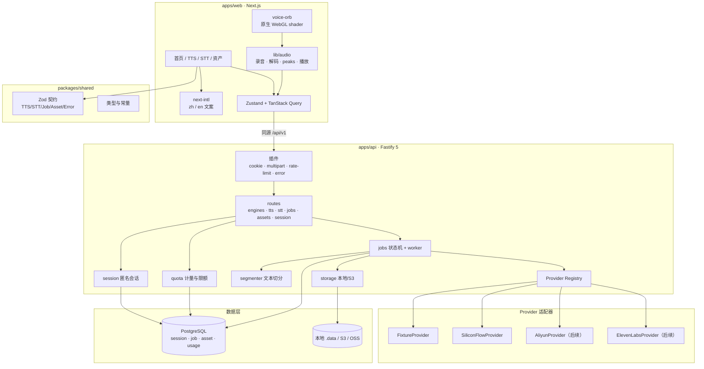
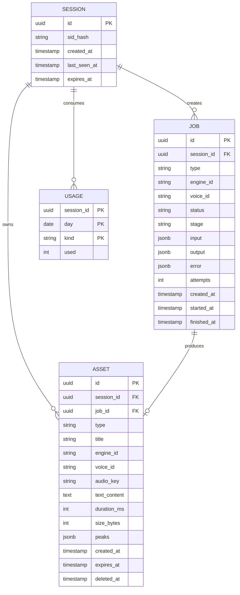
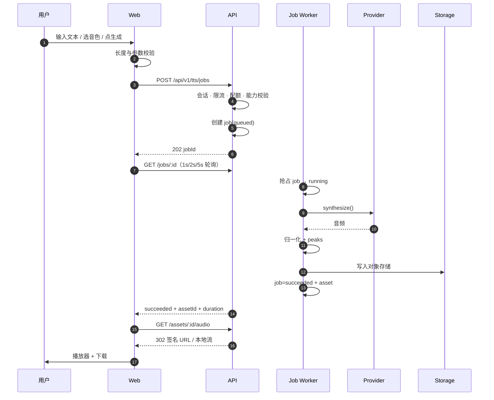
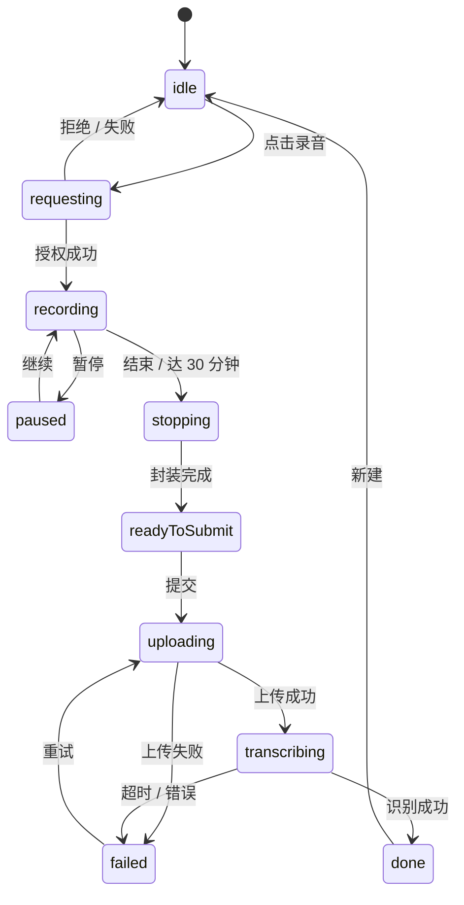

# 声屿 Aural · 实现方案设计

| 项目 | 内容 |
|---|---|
| 日期 | 2026-10-31 |
| 状态 | 待评审 |
| 依据 | `AI语音工作台_PRD_声屿Aural_v1.0.md`（v1.5）、`aural-prototype-v2.html` |
| 定位 | 从 PRD 到可开发任务之间的实现设计；不含开发任务编号与排期看板（下一份文档） |

---

## 1. 意图与为什么

声屿是一个把文字变成声音、把声音变回文字的工作台。视觉上像一间声学实验室，交互上把「输入 → 生成 → 试听 → 带走」做成一条连续路径。

这次实现的目标不是做原型，也不是做演示：**别人可以用**。因此在「视觉可看」之外，必须先成立三件事：

1. 真实音频链路（不是 `SpeechSynthesis`、不是随机数频谱）。
2. 真实任务生命周期（排队、执行、失败、重试、取消、过期）。
3. 真实数据归属（匿名会话、资产留存、配额、签名访问）。

同时接受一个明确约束：**语音模型不锁定**。第一版不围绕某一家厂商设计，而是先做一层足够薄的 Provider 抽象，让「换一家」成为新增一个适配器文件，而不是改业务代码。

---

## 2. 目标 / 非目标 / 反目标

### 2.1 目标（MVP 必须成立）

| # | 目标 | 可验证结果 |
|---|---|---|
| G1 | TTS 闭环 | 输入 ≤ min(5,000, 当前引擎上限) → 生成 → 播放（波形/seek/倍速）→ 下载 mp3 |
| G2 | STT 闭环 | 录音或上传 → 识别 → 可编辑文本 → 复制 / 导出 TXT |
| G3 | 首页完整闭环 | 按住说话 → 出文字；回车 → 球体用**真实 TTS 音频**朗读 |
| G4 | 匿名会话资产 | 刷新后资产仍在；30 天到期；可删除 |
| G5 | Provider 可插拔 | `FixtureProvider` + `SiliconFlowProvider` 并存；已注册适配器之间切换只改环境变量，新增厂商 = 新文件 + 注册一行 |
| G6 | 状态可解释 | TTS 六态、录音五态各有独立视觉与文案；失败都有下一步动作 |
| G7 | 可公开访问 | 单实例可部署；Key 不出现在前端产物；有基础限流与配额 |

### 2.2 非目标（本期不做）

- 注册登录、用户中心、付费订阅
- AI 对话、AI 朗读长文、声音克隆、多角色
- 实时流式 STT（WebSocket）、SSE 推送（MVP 用轮询）
- SRT / VTT、说话人分离、时间戳跳转
- 多区域部署与数据出境方案

### 2.3 反目标（做出来也算失败）

- 用随机数或定时器伪造频谱、进度、电平。
- 前端硬编码某家厂商的参数能力。
- 为了「炫」引入 three.js / GSAP / 一整套 UI 组件库。
- 首访路径上新增任何入口、弹窗或引导，让第一次生成变慢。
- 用 `localStorage` 存音频或不可恢复的资产。

---

## 3. 约束与假设

| 项 | 取值 | 说明 |
|---|---|---|
| 团队 | **单人开发**（本设计的假设） | 按里程碑推进，不按固定周排期承诺 |
| 语音账户 | 暂无 | 先接 `FixtureProvider`；真实适配器首选硅基流动 |
| 市场 | 音频中英双语；界面中英双语可切换；中国大陆可直连 | 国内供应商优先；界面从 S1 起引入 i18n |
| 浏览器 | Chrome/Edge 最近两个大版本、Safari ≥16.4 | 录音格式与 Web Audio 需真机验证 |
| 部署 | 先本地，S4 再定云 | 国内公开访问涉及备案，属于上线前置项 |
| 预算 | 开发期零语音支出 | fixture 不花钱；硅基流动用赠送额度 |
| 文本上限 | 单次 min(5,000, 引擎上限) | 超长分段是 P1 |
| 音频上限 | 20MB / 30 分钟 | 前端预校验 + 服务端复验 |
| 账号 | 匿名会话（httpOnly Cookie） | 不做登录，保留 `user_id` 迁移位 |

---

## 4. 已定决策

用户已确认的用「用户」标注，其余是实现侧判断。

| # | 决策 | 结论 | 来源 |
|---|---|---|---|
| D1 | 是否锁定语音厂商 | 不锁定；先做 Provider 抽象 | 用户 |
| D2 | 首个真实适配器 | 硅基流动 SiliconFlow | 用户 |
| D3 | 账号体系 | 匿名会话，httpOnly Cookie + `sid_hash` | PRD D3 |
| D4 | 技术栈 | Next.js + Fastify + PostgreSQL + S3 兼容存储 | PRD |
| D5 | 仓库形态 | pnpm workspaces：`apps/web` + `apps/api` + `packages/shared` | 我的判断 |
| D6 | ORM | Drizzle（SQL 优先、轻量、迁移可读） | 我的判断 |
| D7 | 任务推送 | MVP 用轮询；SSE 留到 Phase 2 | PRD |
| D8 | 首页朗读 | 生产必须用后端返回的 TTS 音频，不用 `SpeechSynthesis` | PRD 13.1 |
| D9 | 开发期存储 | 本地文件系统适配器；生产切 S3/OSS | 我的判断 |
| D10 | 引擎与音色数据 | 代码内注册表为唯一事实来源，**不建 ENGINE/VOICE 表** | 我的判断 |
| D11 | 波形峰值 | 服务端 ffmpeg 解码计算 120 桶，随资产返回 | 我的判断 |
| D12 | 长文本 | P0 超限拦截；P1 按句切分 ≤1,000 字顺序合成 | PRD |
| D13 | UI 组件 | Radix primitives + 自建 `ui/`，不引整套皮肤 | 我的判断 |
| D14 | 客户端状态 | Zustand（UI）+ TanStack Query（服务端状态与轮询） | PRD + 我的判断 |
| D15 | 样式 | Tailwind v4 + CSS 变量承载 PRD 12.2 的 token | 我的判断 |
| D16 | 界面语言 | 中英双语切换，从 S1 引入 next-intl | 用户（双语）；next-intl 为我的选型 |

**D10 的理由**：引擎能力与音色清单是「代码声明」，不是用户数据。放进数据库会立刻产生两份事实来源，适配器改了能力、数据库没同步，前端就会渲染错误的可用性。MVP 用注册表导出 `GET /engines`，等出现「运营后台改音色上下架」的明确需求再建表。

---

## 5. 系统结构



**边界规则**

1. 组件不直接 `fetch`；请求全部收口在 `features/*/api.ts` + TanStack Query hooks。
2. 所有音频处理收口在 `lib/audio`，组件只消费结果。
3. 业务层不出现厂商名、厂商错误码、厂商参数名。
4. Web 与 API 同源：Next.js `rewrites` 把 `/api/v1/*` 转到 API 进程，避免 CORS 与 Cookie 跨站问题。
5. `packages/shared` 不依赖运行时框架，只放类型、Zod schema、错误码、纯函数常量。

---

## 6. 仓库结构

```
aural/
├─ apps/
│  ├─ web/
│  │  ├─ app/
│  │  │  ├─ [locale]/
│  │  │  │  ├─ page.tsx              # 首页（球体）
│  │  │  │  ├─ tts/page.tsx
│  │  │  │  ├─ stt/page.tsx
│  │  │  │  ├─ library/page.tsx
│  │  │  │  └─ settings/page.tsx
│  │  │  ├─ layout.tsx
│  │  │  └─ globals.css
│  │  ├─ messages/{zh.json,en.json}
│  │  ├─ i18n/{routing.ts,request.ts}
│  │  ├─ components/
│  │  │  ├─ voice-orb/
│  │  │  ├─ waveform/
│  │  │  ├─ player/
│  │  │  ├─ recorder/
│  │  │  ├─ config-panel/
│  │  │  ├─ asset-row/
│  │  │  ├─ voice-picker/
│  │  │  └─ ui/
│  │  ├─ features/
│  │  │  ├─ tts/  { api.ts, hooks.ts, store.ts }
│  │  │  ├─ stt/
│  │  │  ├─ assets/
│  │  │  ├─ engines/
│  │  │  └─ session/
│  │  ├─ lib/
│  │  │  ├─ api-client.ts
│  │  │  ├─ audio/{decode.ts,peaks.ts,recorder.ts,player.ts}
│  │  │  └─ format.ts
│  │  ├─ next.config.ts              # rewrites: /api/v1/* → API_ORIGIN
│  │  └─ package.json
│  └─ api/
│     ├─ src/
│     │  ├─ server.ts
│     │  ├─ plugins/
│     │  ├─ routes/
│     │  ├─ modules/{session,quota,jobs,segmenter,storage}
│     │  ├─ providers/{registry.ts,types.ts,fixture/,siliconflow/}
│     │  └─ db/{schema.ts,client.ts,migrations/}
│     └─ package.json
├─ packages/
│  └─ shared/
│     ├─ src/{contracts.ts,errors.ts,types.ts,constants.ts}
│     └─ package.json
├─ docker-compose.yml                # 仅 PostgreSQL
├─ pnpm-workspace.yaml
├─ package.json
└─ .env.example
```

开发期只需要 Docker 起 PostgreSQL；对象存储用本地目录，不强制 MinIO。

---

## 7. 领域契约（packages/shared）

契约是整个系统的支点：前端、API、适配器、测试都依赖它。

```ts
// 能力声明：由适配器提供，前端据此渲染，业务层不得推断
export type TTSCapabilities = {
  streaming: boolean;
  pitch: boolean;
  volume: boolean;
  ssml: boolean;
  clone: boolean;
  maxCharsPerRequest: number;
  formats: Array<'mp3' | 'wav' | 'opus'>;
  languages: string[];        // BCP-47 或 'auto'
};

export type STTCapabilities = {
  streaming: boolean;
  timestamps: boolean;
  diarization: boolean;
  maxAudioSeconds: number;
  languages: string[];
};

export type TTSRequest = {
  text: string;
  voiceId: string;
  language?: string;
  speed?: number;             // 0.5–2.0
  pitch?: number;             // 半音，仅能力支持时
  volume?: number;
  format?: 'mp3' | 'wav' | 'opus';
};

export type TTSResult = {
  audio: ReadableStream | Buffer;
  format: 'mp3' | 'wav' | 'opus';
  durationMs?: number;
  sampleRate?: number;
};

export type STTRequest = {
  audio: ReadableStream | Buffer;
  mimeType: string;
  language?: string | 'auto';
  timestamps?: boolean;
  diarization?: boolean;
};

export type STTResult = {
  text: string;
  language?: string;
  segments?: Array<{ text: string; startMs: number; endMs: number; speaker?: string }>;
  durationMs?: number;
};

export type Voice = {
  id: string;              // 引擎内唯一，如 'qingchuan'
  engineId: string;
  name: string;
  language: string;        // BCP-47
  gender?: 'female' | 'male' | 'neutral';
  style?: string[];
  previewUrl?: string;     // 供应商预置试听；没有则由服务端合成缓存
  enabled: boolean;
};

export interface TTSProvider {
  readonly id: string;
  readonly displayName: string;
  readonly tier: 'standard' | 'hd';
  readonly capabilities: TTSCapabilities;
  listVoices(language?: string): Promise<Voice[]>;
  synthesize(req: TTSRequest, signal?: AbortSignal): Promise<TTSResult>;
}

export interface STTProvider {
  readonly id: string;
  readonly displayName: string;
  readonly capabilities: STTCapabilities;
  transcribe(req: STTRequest, signal?: AbortSignal): Promise<STTResult>;
}
```

**voiceId 约定**：对外统一用复合 ID `"{engineId}:{localId}"`，例如 `siliconflow:qingchuan`。适配器只接收本地 ID；路由在调用前校验归属并剥离前缀。试听路由使用 URL 编码后的复合 ID。

**任务状态**

```ts
export type JobStatus =
  | 'queued' | 'running' | 'succeeded' | 'failed' | 'cancelled' | 'expired';

export type JobStage =
  | 'validating' | 'queued' | 'synthesizing' | 'encoding'
  | 'uploading' | 'transcribing' | 'done';
```

**错误码**：沿用 PRD 11.10 的表。适配器负责把厂商错误翻译成内部码，业务层与前端只认识内部码。`retryable` 由服务端给出，前端只按它决定是否显示「重试」。响应里的 `message` 只用于日志与兜底；界面文案由前端按错误码在 i18n 文案表中映射。

**引擎视图**（给前端的最小信息）

```ts
type EngineView = {
  id: string;
  kind: 'tts' | 'stt';
  displayName: string;
  tier: 'standard' | 'hd';
  capabilities: TTSCapabilities | STTCapabilities;
  voiceCount: number;
  languages: string[];
};
```

---

## 8. 数据模型

只建四张表。引擎与音色不进库（D10）。



**规则**

1. `job.input` 存原始参数，便于回放与复盘；不存敏感信息。
2. `asset` 只存对象存储 key，URL 每次签发。
3. 删除是软删：`deleted_at` 置位，24 小时内异步清理对象；元数据 7 天后物理删除。
4. `usage` 按 `(session_id, day, kind)` 累加，做日额度；不在内存里计数。
5. 所有时间用 UTC 存储，展示时转本地。
6. 匿名资产 30 天到期；到期前 3 天在资产库顶部提示。
7. session 有效期 1 年，按 `last_seen_at` 滑动续期；资产 30 天从创建时算，独立于 session，清理只删 `expires_at` 已过的 session。
8. STT 源音频在上传时写入临时 key，记录在 `job.input.audioKey`；识别成功后 `asset.audio_key` 复用同一 key（资产库可回放源音频），失败则 24 小时后清理；重试直接复用该 key，不重新上传。

**索引**

- `jobs(status, created_at)`：worker 取任务。
- `jobs(session_id, created_at desc)`：会话内任务查询（可选）。
- `assets(session_id, created_at desc)`：资产列表。
- `assets(expires_at)`：清理任务。
- `sessions(expires_at)`：会话清理。

---

## 9. API 设计

统一前缀 `/api/v1`。除下载跳转外全部 JSON。

### 9.1 会话

| 方法 | 路径 | 说明 |
|---|---|---|
| GET | `/session` | 首次访问生成 `sid` Cookie，返回会话、配额、到期时间 |
| DELETE | `/session/data` | 清空当前会话全部资产（软删 + 异步清理） |

`sid`：32 字节随机值，`httpOnly`、`SameSite=Lax`、`Path=/`、1 年。服务端只存 `sha256(sid)`。所有资产访问都校验 `session_id` 归属。

### 9.2 引擎与音色

| 方法 | 路径 | 说明 |
|---|---|---|
| GET | `/engines?kind=` | 注册表中 `enabled` 的引擎与能力 |
| GET | `/voices?engineId=&language=&q=` | 适配器返回的音色 |
| GET | `/voices/:voiceId/preview` | 302 到试听音频；`voiceId` 为 URL 编码的复合 ID。无预置试听时同步合成 2.5s 样例，缓存 7 天，不计入用户配额，超时 10s |

### 9.3 TTS

| 方法 | 路径 | 说明 |
|---|---|---|
| POST | `/tts/jobs` | 创建合成任务，202 返回 `jobId` |
| GET | `/jobs/:jobId` | 轮询任务状态 |
| DELETE | `/jobs/:jobId` | 取消未完成任务 |

请求：

```json
{
  "text": "让文字拥有声音。",
  "engineId": "siliconflow",
  "voiceId": "siliconflow:qingchuan",
  "language": "zh",
  "speed": 1.0,
  "format": "mp3"
}
```

响应 202：

```json
{ "jobId": "job_01J9Z3K2", "status": "queued", "createdAt": "2026-10-31T06:12:03Z" }
```

轮询响应：

```json
{
  "id": "job_01J9Z3K2",
  "type": "tts",
  "status": "succeeded",
  "stage": "done",
  "progress": null,
  "output": { "assetId": "ast_01J9Z4A1", "durationMs": 12400 },
  "createdAt": "2026-10-31T06:12:03Z",
  "finishedAt": "2026-10-31T06:12:05Z"
}
```

`progress` 只在供应商返回真实进度时给数字，否则 `null`。**前端不得据此推算百分比。**

### 9.4 STT

| 方法 | 路径 | 说明 |
|---|---|---|
| POST | `/stt/jobs` | `multipart/form-data`：`file` + `language` + `timestamps` + `diarization` |
| GET | `/jobs/:jobId` | 同 TTS，`type=stt` |

服务端复验顺序：`Content-Length` → MIME → 魔数 → 解码 → 时长。任何一步失败返回 `UNSUPPORTED_MEDIA` 或 `PAYLOAD_TOO_LARGE`，并给出可执行提示。

### 9.5 资产

| 方法 | 路径 | 说明 |
|---|---|---|
| GET | `/assets?type=&engineId=&cursor=&limit=20` | 时间倒序，游标分页 |
| GET | `/assets/:id` | 元数据 |
| PATCH | `/assets/:id` | 重命名 |
| DELETE | `/assets/:id` | 软删 |
| GET | `/assets/:id/audio` | 302 到 5 分钟签名 URL（本地存储时直接流式返回） |
| GET | `/assets/:id/peaks` | 120 桶峰值，缓存 1 天 |

### 9.6 轮询策略

TanStack Query 的 `refetchInterval` 函数：

| 已轮询次数 | 间隔 |
|---|---|
| 1–5 | 1s |
| 6–60 | 2s |
| >60 | 5s |

页面隐藏时暂停（`refetchIntervalInBackground: false`）。任务进入终态立即停止。60 秒只是轮询降频阈值，不是过期阈值；服务端硬过期是 30 分钟（§11.1），过期后前端显示「任务超时，重试」。

---

## 10. 前端实现

### 10.1 页面与状态归属

| 页面 | 数据来源 | 状态归属 |
|---|---|---|
| `/` 首页 | `/engines`、`/voices`、最近资产 | TanStack Query + 本地 `orb` 状态 |
| `/tts` | `/engines`、`/voices`、任务轮询 | Zustand 存编辑器与参数；Query 存任务/资产 |
| `/stt` | 录音本地状态、任务轮询 | Zustand 存录音机状态；Query 存任务 |
| `/library` | `/assets` 无限滚动 | Query |
| `/settings` | localStorage + `/session` | 本地 |

高频变化（播放进度、录音电平、球体振幅）**不进 React state**：用 `ref` 直接改 Canvas / CSS 变量，避免每帧重渲染。

### 10.2 首页球体

- 单个 `<canvas>` 全屏 quad + fragment shader，逻辑与 `aural-prototype-v2.html` 中的 `FS` 一致（fbm + 边缘光 + 鼠标视差）。
- 尺寸 `min(640px, 76vw, 54vh)`；DPR 上限 1.75；`document.hidden` 时停止 rAF。
- 四态：`idle / listening / thinking / speaking`。
- `listening`：麦克风 → `AnalyserNode` → 72 段外环 + 球体增亮。
- `thinking`：松开且时长 ≥0.45s 后进入；调用 STT，**不是定时器假装识别**。
- `speaking`：回车后创建 TTS 任务 → 轮询 → 取音频 → `decodeAudioData` → `AudioBufferSourceNode` → `AnalyserNode` → 外环与球体用真实 FFT 驱动。
- 无 WebGL 时降级为 CSS 径向渐变；`prefers-reduced-motion` 时停呼吸与视差，保留状态变化。
- 首次进入只有在用户交互后才创建 `AudioContext`，并在手势内 `resume()`（Safari 约束）。

**与原型的关键差异**：原型用 `SpeechSynthesis` 发声、用 `onboundary` 驱动声呐环；生产改为真实音频 + 真实 FFT。这是 PRD 明确要求，不能沿用原型做法。

### 10.3 音色与引擎选择器

- 触发器是球体右上方的标注胶囊（PRD 12.7），展示 `voice.name` + `tier`。
- 浮层内容来自 `/engines` 与 `/voices`：引擎分段控件 + 音色行（名称、性别、风格、语种、试听）。
- 试听：`GET /voices/.../preview`，同一时间只播一个；进行中的试听再次点击即停止。
- 切换音色：更新胶囊、球体色相 ±8°、写入 localStorage 的「上次选择」。
- 能力差异不隐藏：引擎不支持音调时，TTS 页的音调滑块置灰并给 tooltip。

### 10.4 TTS 工作台

- 左栏编辑器（约 62%）+ 右栏配置（340px）；播放器是横跨左栏的独立舞台。
- 文本域：初始 6 行，最高 60vh 后内部滚动；右下角计数（<80% 灰、80–100% 琥珀、超限红）。上限取 `min(5,000, engine.capabilities.maxCharsPerRequest)`，超出时文案说明「当前引擎最多 N 字」。
- 生成：按钮进入 loading 并锁定；`⌘/Ctrl + Enter` 提交。
- 状态条：`queued → synthesizing → encoding → ready / failed`，每态独立文案；只有服务端给 `progress` 才显示百分比。

**状态映射（后端 → 界面）**

| 后端 status / stage | 界面状态 | 主文案 |
|---|---|---|
| —（前端校验） | validating | 正在检查文本… |
| queued | queued | 排队中 |
| running / synthesizing | synthesizing | 正在合成 |
| running / encoding | encoding | 正在处理音频 |
| succeeded | ready | 生成完成 |
| failed | failed | 生成失败 |
| cancelled | cancelled | 已取消 |
| expired | expired | 任务超时 |

PRD 说的「六态」指 `validating / queued / synthesizing / encoding / ready / failed`；`cancelled`、`expired` 复用失败卡片布局，文案与操作不同（取消无重试，过期给重试）。
- 播放器：
  - `AudioBufferSourceNode`，不用 `<audio>`，为了精确 seek、接 Analyser、统一倍速。
  - 静态波形来自服务端 peaks；160 根镜像柱；已播部分青→紫渐变，播放头 28px 光晕。
  - 径向频谱 64 段，来自 `AnalyserNode`，`smoothingTimeConstant = 0.82`；仅播放时更新。
  - 空白态保持布局，整体降透明度，显示「生成后在这里试听」。
  - 下载：`GET /assets/:id/audio`，文件名 `aural-{voice}-{yyyymmdd-hhmm}.mp3`。
- 重新生成保留当前参数，旧结果本次会话内仍可下载。

### 10.5 STT 工作台

- 左栏录音舞台（sticky，420–480px），右栏结果；移动端上下排列。
- 录音状态机：`idle → requesting → recording ⇄ paused → stopping → readyToSubmit → uploading → transcribing → done / failed`。

**状态映射（内部 → 展示七态）**

| 内部状态 | 展示状态 |
|---|---|
| idle | 等待 |
| requesting | 请求权限 |
| recording | 录音中 |
| paused | 已暂停 |
| stopping / readyToSubmit | 识别中 · 正在封装 |
| uploading | 识别中 · 正在上传 |
| transcribing | 识别中 · 已用时 Ns |
| done | 完成 |
| failed | 失败 |
- 权限：点击录音时才 `getUserMedia`；拒绝后显示浏览器设置路径与「重新检测」。
- 录音：优先 `MediaRecorder`（Chrome webm/opus，Safari mp4）；不可用时降级 `AudioWorklet` 采 PCM + WAV 封装。计时 30 分钟自动结束；≥25 分钟变琥珀。
- 实时波形：`AnalyserNode`，30–60fps；无声音时贴近基线但不完全静止。
- 上传：拖拽/点击；格式、大小、时长前端预校验，服务端复验；文件卡片可删除重传。
- 结果：可编辑 textarea；复制、导出 TXT、重新识别（音频保留，不重新上传）。
- 录音中刷新/关闭页面用 `beforeunload` 提示。

### 10.6 样式与视觉

- 设计 token 直接映射 PRD 12.2 与原型 CSS 变量：`--bg-base`、`--e1`、`--violet` 等。
- 字体：Geist/Inter + JetBrains Mono 自托管子集；中文回退 `PingFang SC` / `Microsoft YaHei`，不加载中文字体包。
- 圆角：控件 10、卡片 16、面板 24；青色只出现在音频相关元素。
- 动效按 PRD 14.2 清单实现；`prefers-reduced-motion` 下停装饰动画。
- 自定义光标仅桌面、首次移动后出现；触控禁用。

### 10.7 响应式

| 断点 | 布局 |
|---|---|
| <640 | 单列；播放器进视野；配置在编辑器下方 |
| 640–1024 | 单列；配置折叠为抽屉 |
| 1024–1440 | TTS 双栏（1fr / 340px） |
| ≥1440 | 内容最大宽 1320；播放器常驻 |

移动端触控目标 ≥44×44；底部安全区 `env(safe-area-inset-bottom)`。

### 10.8 国际化（i18n）

- 方案：**next-intl**，App Router 原生支持；文案放 `apps/web/messages/{zh,en}.json`，按命名空间组织（`nav`、`home`、`tts`、`stt`、`library`、`errors`）。
- 路由：`app/[locale]/...`，`localePrefix: 'as-needed'`；默认 `zh`，英文为 `/en/...`。语言选择写入 `NEXT_LOCale` Cookie，服务端与客户端保持一致。
- 所有界面文案必须走 `useTranslations` / `getTranslations`；组件内不得硬编码中文（品牌名「声屿 Aural」、音色专名与用户内容除外）。CI 加一条 grep 检查组件目录的中文字符串。
- **错误文案**：API 只返回错误码、`retryable` 与 `details`；前端按错误码从 `errors` 命名空间取文案。服务端的 `message` 只进日志，不直接展示。
- 音色标签：`gender`、`style` 用枚举 key（`female`、`warm` 等）传到前端再翻译；供应商返回的未知标签原样显示。
- 数字、日期、时长用 `Intl` 按 locale 格式化；时长仍用等宽字体。
- `<html lang>` 随 locale 更新；英文文案通常比中文长 20–30%，布局不得依赖固定宽度。
- 测试：Playwright 的黄金路径在 `zh` 与 `en` 各跑一遍；390px 下两种语言都不得横向滚动。

---

## 11. 后端实现

### 11.1 任务执行模型

MVP 不引入 Redis / BullMQ。用 PostgreSQL 做队列，API 进程内起一个 worker 协程。

```sql
UPDATE jobs
SET status = 'running', stage = 'synthesizing',
    started_at = now(), attempts = attempts + 1
WHERE id = (
  SELECT id FROM jobs
  WHERE status = 'queued'
  ORDER BY created_at
  LIMIT 1
  FOR UPDATE SKIP LOCKED
)
RETURNING *;
```

- 全局并发默认 3（环境变量可调）；单会话并发 1。
- 进程重启：`status='running'` 且 `started_at < now() - interval '10 minutes'` 的任务重新入队（`attempts < 2`）或标记 `failed`。
- 任务执行：调用 Provider → 归一化音频（ffmpeg 转 mp3 24kHz 单声道，若已是目标格式则跳过）→ 上传存储 → 计算 peaks → 写资产 → 更新任务。
- 取消：`DELETE /jobs/:id` 对未完成任务置 `cancelled`；worker 每段开始前检查状态。
- 过期：任务创建后超过 30 分钟未完成置 `expired`（硬上限，覆盖所有分段）；Provider 的 15s/90s/120s 是单次调用超时，不是任务过期。

### 11.2 文本分段（P1）

- 按句末标点（。！？!?；;\n）切分，单段 ≤1,000 字符；无法切分时按逗号，再不行硬切。
- 顺序合成，单段失败只重跑该段；全部完成后 ffmpeg concat。
- 任务 `input.segments` 记录切分结果，`output.segmentIndex` 暴露「第 x/y 段」。

### 11.3 音频归一化与 peaks

- `ffprobe` 读时长、采样率、声道；不依赖用户文件名。
- `ffmpeg -f s16le -ac 1 -ar 8000 -` 输出 PCM，按 120 桶取最大绝对值并归一化，写入 `assets.peaks`。
- 时长写入 `assets.duration_ms`；STT 上传也复用这套探测逻辑。
- 若 ffmpeg 不可用，启动时直接失败并打印安装提示，不做静默降级（避免假数据）。

### 11.4 存储

```ts
interface Storage {
  put(key: string, data: Buffer | ReadableStream): Promise<{ size: number }>;
  getStream(key: string): Promise<ReadableStream>;
  signedUrl(key: string, ttlSec: number): Promise<string>;
  delete(key: string): Promise<void>;
}
```

- `LocalStorage`：写到 `.data/audio/...`，`signedUrl` 返回带短期 `token` 的 API 路径。
- `S3Storage`：S3 兼容（OSS/R2），私有桶，5 分钟预签名。
- Key：`audio/YYYYMM/<sidHash>/<assetId>.mp3`。

### 11.5 会话与配额

- 首次请求无 `sid`：生成并种 Cookie，创建 session 记录。
- 配额：TTS 20,000 字符/日，STT 1,800 秒/日。
- 记账时机：
  - TTS：创建任务时按文本长度**预检**，成功后才写入 `usage`；失败、取消、过期不扣。
  - STT：上传后用 ffprobe 得到真实时长，再**预检**；识别成功后才写入；失败不扣。
  - 预检不通过返回 `QUOTA_EXCEEDED`（402）；STT 此时删除临时文件。
- 单会话并发 1、单 IP 20 任务/分钟，防止预检被绕过。
- 限流：`@fastify/rate-limit`，单 IP 20 任务/分钟（429 + `Retry-After`）。

### 11.6 清理任务

进程内每日一次（`setInterval` + 启动时补跑）：

- 过期 session 与其资产：软删 + 对象清理。
- 过期资产（30 天）：同上。
- 失败任务临时音频（24 小时）。
- 软删元数据 7 天后物理删除。

MVP 单实例，不需要分布式锁；多实例时改为抢占式清理并加唯一约束。

---

## 12. Provider 适配层

### 12.1 注册表

```ts
// apps/api/src/providers/registry.ts
// 只注册环境变量声明的适配器；fixture 是否可见由配置决定
const ttsProviders = buildTTSProviders(env.TTS_PROVIDERS);   // 'fixture,siliconflow'
const sttProviders = buildSTTProviders(env.STT_PROVIDERS);

export const registry = {
  resolveTTS(id: string): TTSProvider {
    const p = ttsProviders.find(x => x.id === id);
    if (!p) throw new AppError('INVALID_ARGUMENT', `未知引擎：${id}`);
    return p;
  },
  defaultTTS(): TTSProvider { /* env.DEFAULT_TTS_PROVIDER */ },
  list(): EngineView[] { /* 当前注册的全部引擎与能力 */ },
};
```

环境变量：

```bash
TTS_PROVIDERS=fixture,siliconflow   # 出现在 /engines 的引擎
STT_PROVIDERS=fixture,siliconflow
DEFAULT_TTS_PROVIDER=siliconflow
SILICONFLOW_API_KEY=sk-...
SILICONFLOW_TTS_MODEL=...
SILICONFLOW_STT_MODEL=...
```

生产环境设 `TTS_PROVIDERS=siliconflow`、`STT_PROVIDERS=siliconflow`，fixture 根本不注册，不靠 `enabled=false` 隐藏；因此接口不需要 `enabled` 字段。开发默认同时注册两家，方便对照。

### 12.2 SiliconFlow 适配器

- 走 OpenAI 兼容协议：TTS `POST /v1/audio/speech`，STT `POST /v1/audio/transcriptions`。
- 具体模型 ID、音色列表、参数支持**以接入当天官方文档为准**，集中写在适配器顶部的常量里，不散落到业务代码。
- 能力声明写死为适配器自己的判断：例如 `pitch: false`（若协议不支持），前端据此置灰。
- 错误映射：`401 → UNAUTHORIZED`、`429 → RATE_LIMITED`、`5xx → PROVIDER_UNAVAILABLE`、超时 → `PROVIDER_TIMEOUT`。
- 超时：TTS 15s 首包 / 90s 完成；STT 120s；最多重试 1 次。

### 12.3 Fixture 适配器

- TTS：返回内置的 2–3 个 WAV 片段（按文本长度选择），保证开发、测试、E2E、演示都能听到声音且不花钱。
- STT：按音频时长返回固定但合理的文本；用于状态机与 E2E。
- Fixture 必须标记 `id: 'fixture'`、`displayName: '本地示例'`；生产环境通过不把它列入 `TTS_PROVIDERS` / `STT_PROVIDERS` 来隐藏。

### 12.4 新增一家厂商的清单

1. 新建 `providers/<vendor>/{index.ts,tts.ts,stt.ts}`。
2. 实现接口，声明 `capabilities` 与 `tier`。
3. 在注册表加一行，`enabled` 由环境变量控制。
4. 补错误映射单测与一条 E2E 冒烟。
5. 业务代码零改动。

---

## 13. 关键流程

### 13.1 TTS



### 13.2 录音转写



失败与降级的判定沿用 PRD 7.4：网络超时自动重试 1 次；供应商 5xx 切备用（MVP 无备用则提示换引擎）；额度不足、内容拒绝、参数不支持分别给出对应引导。

---

## 14. 测试策略

| 层 | 工具 | 覆盖 |
|---|---|---|
| 单测 | Vitest | shared schema、分段器、错误映射、peaks 纯函数、注册表能力过滤 |
| API 集成 | Fastify `inject` + fixture provider + LocalStorage + 测试 PG | 建任务、轮询、资产归属、配额、删除、非法上传 |
| E2E | Playwright | 首页按住说话（fixture STT）、TTS 生成与播放、资产删除、390px 布局 |
| 兼容 | 手工 | Safari/iOS 录音与播放、权限拒绝、麦克风占用 |
| 性能 | Lighthouse + Performance 面板 | LCP、INP、动画帧率、首屏 JS |

**测试原则**

- 不用 mock 伪造音频可视化；fixture 提供真实音频文件。
- 每个错误码至少一条测试，断言「文案 + 可执行动作」。
- E2E 必须跑一次「刷新后资产仍在」和「换会话访问他人资产返回 403/404」。

---

## 15. 里程碑与顺序

以单人开发估算；PRD 的 51 人日作为总量参考，按每周实际投入换算。

| 里程碑 | 内容 | 出口标准 |
|---|---|---|
| **S0 基建**（3–5 天） | monorepo、shared 契约、Drizzle schema、Fastify 骨架、session、fixture provider、本地存储、`/engines`、`/tts/jobs` + worker、最小 TTS 页面 | `pnpm dev` 后输入文字能听到 fixture 音频并下载 |
| **S1 TTS 闭环**（2–2.5 周） | 编辑器、配置栏、音色选择器、任务状态机、播放器（波形/seek/倍速/下载）、SiliconFlow TTS、失败重试、**i18n 基础设施（zh/en）** | 真实文本经 SiliconFlow 出音频；六态无死锁；Safari 可播；中英切换无硬编码残留 |
| **S2 STT 闭环**（1.5–2 周） | 录音机、权限五态、上传校验、SiliconFlow STT、结果编辑/复制/导出、重试、STT 页面双语 | 30 分钟录音或上传可完成；伪造扩展名被拒；Safari 真机通过；STT 页两种语言完整 |
| **S3 资产与打磨**（1 周） | 资产库、删除/重命名、配额、设置、动效、a11y、390px、资产/设置页双语补全 | PRD 第 20 章检查清单 90% 通过；两种语言 390px 无溢出 |
| **S4 硬化与上线**（1 周） | 错误体系收口、日志与监控、限流、部署（先本地/内网，再定云）、备案与合规检查 | 公网可访问；构建产物无 Key；删除与留存任务生效 |

**顺序理由**：S0 先把契约与 fixture 跑通，保证后面每一步都能独立验证；S1 接真实 TTS，尽早暴露供应商与音频链路问题；S2 的录音是最大的兼容性风险，留足时间；S3 再做视觉打磨，避免在功能未闭环时反复改布局。

---

## 16. 风险与应对

| 风险 | 信号 | 应对 |
|---|---|---|
| Safari 首次播放无声 | iOS 点击播放无反应 | 在用户手势内创建并 `resume()` AudioContext；保留 `<audio>` 兜底路径 |
| MediaRecorder 格式不统一 | Safari mp4、Chrome webm | 前端声明真实 MIME，服务端统一转码 |
| 硅基流动接口与预期不符 | 模型 ID、参数、返回结构差异 | 适配器内集中配置；接入当天核对文档；fixture 保证开发不被阻塞 |
| 长文本超时 | 5,000 字 >90s | P0 拦截；P1 分段 + 单段重试 |
| 匿名会话丢失 | 清 Cookie 后资产消失 | 资产库顶部一句话说明；不做「找回」承诺 |
| 单实例故障 | 进程退出 | 健康检查 + 快速重启；任务重启后重新入队 |
| 部署与备案 | 域名无法访问 | S4 前确认云与备案周期；早期用 IP 或内网演示 |
| 需求蔓延 | 出现聊天/克隆/主题切换 | 反目标清单；变更必须回答「是否让首次生成更慢」 |
| 英文文案变长导致布局溢出 | 英文界面按钮换行、标题截断 | 按钮不锁死宽度；两种语言都跑 390px；关键操作文案允许两行 |

---

## 17. 验收标准

沿用 PRD 第 20 章，MVP 提测时逐项打勾。这里只列实现侧必须额外确认的项：

- [ ] 构建产物中 grep 不到任何供应商 Key 前缀。
- [ ] 所有任务状态都有对应 UI；没有「转圈但不知道在干什么」。
- [ ] 任意失败都能回答：发生了什么、是否扣费、下一步做什么。
- [ ] 频谱、波形、电平在无音频时明显静止；没有随机数驱动的假动画。
- [ ] 换一家 Provider 只改环境变量与注册表，业务代码零改动。
- [ ] 刷新页面后资产仍在；换一个浏览器会话访问他人资产被拒。
- [ ] `prefers-reduced-motion` 下装饰动画停止，功能动画降级为透明度。
- [ ] 390 / 768 / 1024 / 1440 四档无横向滚动、无遮挡。
- [ ] 中英两种界面文案完整；切换语言后不出现残留中文或中英混排。
- [ ] 错误码在两种语言下都有对应文案，不直接显示服务端的英文 message。

---

## 18. 留给 builder 的判断

以下项目前不构成设计约束，实现时自行决定：

- 具体依赖版本与升级节奏（Next.js、React、Fastify、Drizzle）。
- 组件内部拆分粒度、hooks 命名、目录细节。
- 测试覆盖率目标与 CI 供应商。
- 日志字段细节、监控与错误上报服务（Sentry 或自建）。
- 部署形态（ECS 单容器 / 函数计算 / 其他），以及是否先上香港节点过渡。
- 资产列表分页用游标还是 offset（当前按游标设计）。
- 设置页的具体字段顺序与默认值。

---

## 19. 参考

- PRD：`docs/reference/AI语音工作台_PRD_声屿Aural_v1.0.md`（v1.5）
- 高保真原型：`docs/reference/aural-prototype-v2.html`（v1 保留作对比）
- 语音能力调研：`docs/reference/语音能力选型调研_TTS_STT_2026-10.md`、`docs/reference/语音能力_需求调研报告_2026-10.md`
- Web Audio API：https://developer.mozilla.org/docs/Web/API/Web_Audio_API
- next-intl：https://next-intl.dev/
- SiliconFlow 文档：接入当天以官网为准
